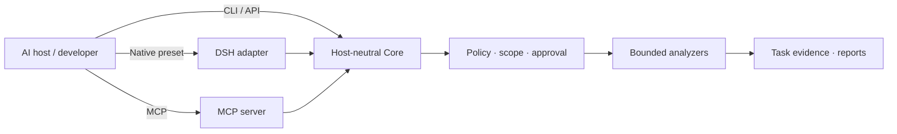

<p align="center">
  
</p>

# ArmorBreak · 破甲

**Evidence-first security analysis for AI agents.**<br>
*Inspect with tools. Enforce scope in code. Keep the evidence.*

ArmorBreak is an open-source toolkit for **authorized** reverse engineering, source-code review, packet analysis, digital forensics, and security research. One host-neutral Core powers **DeepSeek Harness**, **MCP-capable agents**, and **standalone Node.js integrations**. Models can help plan and interpret; they do **not** grant permission to act.

**[Download Stable](https://github.com/LYL-Z/dsh-armorbreak/releases/tag/v2.2.0)** · **[Quick start](#quick-start)** · **[Integrations](#choose-an-integration)** · **[Release verification](#v220-stable-verification)** · **[Documentation](#documentation)** · **[中文](README.zh-CN.md)**

[](https://github.com/LYL-Z/dsh-armorbreak/actions/workflows/ci.yml)


[](LICENSE)

> [!IMPORTANT]
> **V2.2.0 Stable is published.** It covers a **Verified Core** and **Experimental Provider Integrations**. Commercial OpenAI, Anthropic, and Gemini endpoints remain `LIVE_UNVERIFIED`; AI-assisted security review is not human certification. The historical **Full GA** contract remains `gaReady:false` with 18 blockers. Read [release verification](#v220-stable-verification) and [scope/limitations](#scope-and-limitations) before relying on a result.

## Why ArmorBreak?

| The challenge | The design |
| --- | --- |
| Agent integrations reinvent execution | **One Core** behind DSH, MCP, CLI, and application APIs |
| Model output gets confused with permission | **Policy and operator approval** live outside the model |
| Findings are hard to reproduce | **Task-scoped evidence, hashes, findings, and reports** |
| First use assumes a paid model | **Offline L0 analysis**, with optional model integrations |

ArmorBreak is a **research toolkit**, not a guarantee that a target is vulnerable or a substitute for independent security assessment.

## Quick start

### Option A — verify the published Stable release

The release page carries six assets: the portable archive, its build manifest, CycloneDX SBOM, SHA-256 list, Stable Gate result, and GitHub attestation. Use Node.js **22+**; the release CI used Node 24.

```powershell
$rel = Join-Path $env:TEMP 'armorbreak-v2.2.0'
New-Item -ItemType Directory -Force $rel | Out-Null
gh release download v2.2.0 --repo LYL-Z/dsh-armorbreak --dir $rel

Get-FileHash "$rel\armorbreak-portable-2.2.0.tar.gz" -Algorithm SHA256
Get-Content "$rel\SHA256SUMS.txt"   # compare the archive and SBOM hashes

$extract = Join-Path $env:TEMP 'armorbreak-v2.2.0-extracted'
New-Item -ItemType Directory -Force $extract | Out-Null
tar -xzf "$rel\armorbreak-portable-2.2.0.tar.gz" -C $extract
Set-Location $extract
```

Expected archive SHA-256: `5e5aca98da18d4f0cb17db71cf57c5577f8f8f64810a30844bd5237b4ed7b630`<br>
Expected SBOM SHA-256: `2fd47a2b3970c563a747dffb093a33c042de2488b832604dbcce65ec374755a4`

Verify provenance with GitHub CLI:

```powershell
gh attestation verify "$rel\armorbreak-portable-2.2.0.tar.gz" `
  --repo LYL-Z/dsh-armorbreak `
  --cert-identity "https://github.com/LYL-Z/dsh-armorbreak/.github/workflows/attest.yml@refs/heads/main" `
  --source-ref refs/heads/main `
  --source-digest 94d606ed934d7d288c2946ae7d9d25582d8204a4 `
  --predicate-type https://slsa.dev/provenance/v1
```

### Option B — run from the frozen source tag

```powershell
git clone --branch v2.2.0 --depth 1 https://github.com/LYL-Z/dsh-armorbreak.git
cd dsh-armorbreak
```

### First harmless L0 task

From either the extracted release or the tag checkout:

```powershell
$demo = Join-Path $env:TEMP 'armorbreak-first-run'
New-Item -ItemType Directory -Force -Path "$demo/state", "$demo/workspace" | Out-Null
Copy-Item ./README.md "$demo/workspace/README.md"

$env:ARMORBREAK_STATE_ROOT = "$demo/state"
$env:ARMORBREAK_WORKSPACE = "$demo/workspace"
$env:ARMORBREAK_PRINCIPAL_ID = 'first-run-user'

node packages/cli/index.js capabilities --json
node packages/cli/index.js analyze --capability forensics.hash `
  --target "$demo/workspace/README.md" --json
node packages/cli/index.js task list --json
node packages/cli/index.js report <task-id> --json
```

**Expected:** 46 registered capabilities and one completed L0 task with real task ID and evidence. A rejection is not success; inspect `ARMORBREAK_STATE_ROOT`, `ARMORBREAK_WORKSPACE`, path, and policy. The release smoke for this README is recorded in [v4-release-smoke.md](docs/readme-audit/v4-release-smoke.md).

## V2.2.0 Stable verification

| Fact | Recorded value |
| --- | --- |
| Release | [v2.2.0 Stable](https://github.com/LYL-Z/dsh-armorbreak/releases/tag/v2.2.0), published 2026-10-26 |
| Frozen source / tag commit | `94d606ed934d7d288c2946ae7d9d25582d8204a4` |
| Current main at docs baseline | `60273394dff3386354df42ef852964f240a79145` |
| Release CI | [40320111438](https://github.com/LYL-Z/dsh-armorbreak/actions/runs/40320111438), **5/5 jobs success** |
| Exact-source tests | Windows **530/530**, Ubuntu **532/532**, zero failed/skipped/cancelled |
| Stable Gate | **12/12 PASS**, `releasable:true`; attached `stable-gate.json` |
| Provenance | [attestation 40320111461](https://github.com/LYL-Z/dsh-armorbreak/actions/runs/40320111461), `gh attestation verify` succeeded locally |
| Portable archive | 5,338,540 bytes; SHA-256 `5e5aca98da18d4f0cb17db71cf57c5577f8f8f64810a30844bd5237b4ed7b630` |
| CycloneDX SBOM | 88,082 bytes; SHA-256 `2fd47a2b3970c563a747dffb093a33c042de2488b832604dbcce65ec374755a4` |
| Six release assets | archive, build manifest, SBOM, `SHA256SUMS.txt`, `stable-gate.json`, `github-attestation.json` |

The tag and current main are **different commits**. `94d606e…` is the immutable release source; `6027339…` is later docs/test-context maintenance. Do not describe a current-main build as the original release archive.

The original published-tag CI also preserves a **test-context failure**: two assertions assumed the formal tag did not exist yet. [PR #21](https://github.com/LYL-Z/dsh-armorbreak/pull/21) corrected those assumptions without deleting Full GA rejection assertions or skipping tests; post-publication main CI [40322961617](https://github.com/LYL-Z/dsh-armorbreak/actions/runs/40322961617) and attestation [40322961644](https://github.com/LYL-Z/dsh-armorbreak/actions/runs/40322961644) passed. The release assets and original failure record were not rewritten.

## Choose an integration

| You use… | Connect through… | Start here | Verification nuance |
| --- | --- | --- | --- |
| **DeepSeek Harness** | Native Cordis bundle / `armorbreak` preset | [DSH installation](docs/installation.md) | Recorded Desktop L0; not re-tested in this docs QA |
| **MCP-capable Agent** | MCP server with host-specific configuration | [MCP setup](docs/v2/host-generic.md) | Host levels vary: [host matrix](docs/v2/generated/host-matrix.md) |
| **Node.js application** | `createCore({ stateRoot })` | [Core API](docs/v2/core/public-api.md) | Core does not depend on DSH |
| **Local-model experiment** | Core + Provider Router + local runtime | [Ollama evidence](docs/v2/acceptance/provider-live-ollama.json) | Local model ≠ commercial-provider certification |

Codex uses TOML, some MCP hosts use JSON, Hermes uses YAML, and Pi has a native extension. Do not copy one host configuration everywhere.

## Scope and limitations

- **46 capabilities / 8 domains** in the recorded registry: **44 L0, 1 L1, 1 L2**; **L3 denied**. Registration is not a promise that every optional external analyzer is installed.
- **9 workflows; 7 DSH Skills; 10 DSH model tools; 7 MCP tools.** These are different interfaces and must not be added into one tool count.
- **12 host entries / 10 L0 / 9 third-party L0** in the current matrix; each host retains its own evidence level. Claude Code MCP and Claude Cowork CLI, Gemini CLI and Antigravity are separate rows.
- **Verified Core:** Universal Core, MCP server, Skills, Offline Golden, recorded local-model verification, and the installer/migration/rollback paths covered by the release CI.
- **Experimental Provider Integrations:** OpenAI-compatible, OpenAI Responses, Anthropic Messages, and Gemini Native are `LIVE_UNVERIFIED`; mock and local results do not certify commercial endpoints.
- **Historical Full GA:** `gaReady:false`, 18 blockers. Stable is a separate, owner-approved release contract and does not waive Full GA.
- **AI review:** four AI-assisted rounds completed initial review; findings still require remediation/retest. This is not an independent human audit or certification.
- **Provenance:** GitHub OIDC/Sigstore attests build origin and subject binding; it is not a security certification or production code signature.

**Risk levels:** L0 is local/offline; L1 requires usable isolation and platform approval; L2 requires authorized scope and platform approval; L3 is always denied. See [security policy](SECURITY.md), [Stable policy](docs/v2/release/v2.2-stable-policy-v1.md), and [GA review](docs/v2/release/v2.2-ga-review.md).

## How it works



1. **The Agent is not the approval authority.** Policy checks risk, scope, and operator/platform approval.
2. **A finding is not proof of exploitation.** Facts, hypotheses, and unverified leads are separated.
3. **A protocol mock is not a live-provider result.** Model routing and analysis authorization remain separate.

## Documentation

| What you need | Where to go |
| --- | --- |
| Download and checksum the Stable release | [v2.2.0 Release](https://github.com/LYL-Z/dsh-armorbreak/releases/tag/v2.2.0) · [SHA256SUMS](https://github.com/LYL-Z/dsh-armorbreak/releases/download/v2.2.0/SHA256SUMS.txt) |
| Install/uninstall the DSH integration | [Installation guide](docs/installation.md) |
| Run analysis and inspect reports | [Usage guide](docs/usage.md) |
| Connect another Agent | [MCP adapter](docs/v2/host-generic.md) · [host matrix](docs/v2/generated/host-matrix.md) |
| Call the standalone Core | [Core API](docs/v2/core/public-api.md) |
| Verify protocol / provider status | [Provider matrix](docs/v2/provider-matrix.md) · [Golden status](docs/v2/acceptance/golden-status.json) |
| Read Stable policy and release notes | [Stable policy](docs/v2/release/v2.2-stable-policy-v1.md) · [release notes](docs/releases/v2.2.0.md) |
| Audit the release fact record | [v2.2.0 release facts](docs/readme-audit/v2.2.0-release-facts.md) |
| Upgrade or roll back | [Upgrade guide](docs/v2/release/upgrade-guide.md) |
| Review historical Full GA blockers | [GA review](docs/v2/release/v2.2-ga-review.md) · [blocker map](docs/v2/acceptance/blocker-map.json) |
| Explore long-form design and benchmarks | [Archive](docs/readme-archive-v2.2.md) · [Benchmarks](docs/benchmarks.md) |

## Contributing and responsible use

ArmorBreak is intended **only for research and testing within a scope you are authorized to access**. Treat analyzed content as untrusted and verify findings before acting. Read [CONTRIBUTING.md](CONTRIBUTING.md); report suspected vulnerabilities **privately** through [SECURITY.md](SECURITY.md), not a public Issue. Licensed under [MIT](LICENSE).

---

*ArmorBreak · 破甲 — Evidence first. Operator authority. Reproducible results.*
