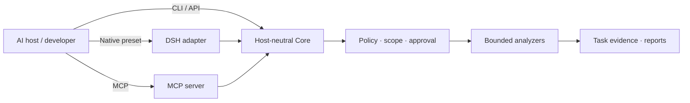

<p align="center">
  
</p>

# ArmorBreak · 破甲

**Evidence-first security analysis for AI agents.**<br>
*Inspect with tools. Enforce scope in code. Keep the evidence.*

ArmorBreak is an open-source toolkit for **authorized** reverse engineering, source-code review, packet analysis, digital forensics, and security research. One host-neutral Core powers **DeepSeek Harness**, **MCP-capable agents**, and **standalone Node.js integrations**. Models can help plan and interpret; they do **not** grant permission to act.

**[Quick start](#try-it-locally)** · **[Integrations](#choose-an-integration)** · **[Real analysis](#a-real-analysis-not-a-mockup)** · **[Documentation](#documentation)** · **[中文](README.zh-CN.md)**

[](https://github.com/LYL-Z/dsh-armorbreak/actions/workflows/ci.yml)


[](LICENSE)

> [!IMPORTANT]
> **Release and assurance:** `2.2.0-rc.1` is an engineering candidate, **not** a full V2.2 GA release or an independently certified security product. Four AI-assisted security reviews have finished their initial passes; findings still require remediation and retesting. Official OpenAI, Anthropic, and Gemini endpoints remain **unverified**. See [verification status](#verification-status) and [security policy](SECURITY.md).

## Why ArmorBreak?

| The challenge | The design |
| --- | --- |
| Agent integrations reinvent execution | **One Core** behind DSH, MCP, CLI, and application APIs |
| Model output gets confused with permission | **Policy and operator approval** live outside the model |
| Findings are hard to reproduce | **Task-scoped evidence, hashes, findings, and reports** |
| First use assumes a paid model | **Offline L0 analysis**, with optional model integrations |

ArmorBreak is a **research toolkit**, not a guarantee that a target is vulnerable or a substitute for independent security assessment.

## Try it locally

**First milestone:** list capabilities and hash a harmless copy of this README in a separate workspace. No commercial model key or network target is required. Run in **PowerShell 7+** with **Node.js 22+**, from the repository root. The same syntax was smoke-tested on Windows PowerShell 5.1 during documentation QA; hashes below vary per file.

```powershell
git clone https://github.com/LYL-Z/dsh-armorbreak.git
cd dsh-armorbreak

$demo = Join-Path $env:TEMP 'armorbreak-first-run'
New-Item -ItemType Directory -Force -Path "$demo/state", "$demo/workspace" | Out-Null
Copy-Item ./README.md "$demo/workspace/README.md"

$env:ARMORBREAK_STATE_ROOT = "$demo/state"
$env:ARMORBREAK_WORKSPACE = "$demo/workspace"
$env:ARMORBREAK_PRINCIPAL_ID = 'first-run-user'

node packages/cli/index.js capabilities --json
node packages/cli/index.js analyze --capability forensics.hash `
  --target "$demo/workspace/README.md" --json
```

**Expected:** a capability listing (46 in the recorded V2.2 registry) and one completed L0 task with a real task ID and evidence. Inspect with `node packages/cli/index.js task list --json`; retrieve a report with `node packages/cli/index.js report <task-id> --json`. A rejection must be diagnosed, **not** counted as success. If you already have a clone, skip the first two commands.

The smoke run for this README completed with `forensics.hash` on a copied README, two evidence records, and a Markdown report. The exact task ID and hashes are recorded in the [DX smoke log](docs/readme-audit/v3-smoke.md); they are illustrative of that isolated run, not a fixed expected output.

## Choose an integration

| You use… | Connect through… | Start here | Verification nuance |
| --- | --- | --- | --- |
| **DeepSeek Harness** | Native Cordis bundle / `armorbreak` preset | [DSH installation](docs/installation.md) | Recorded Desktop L0; not re-tested in previous docs QA |
| **MCP-capable Agent** | MCP server with host-specific configuration | [MCP setup](docs/v2/host-generic.md) | Host validation levels vary: [host matrix](docs/v2/generated/host-matrix.md) |
| **Node.js application** | `createCore({ stateRoot })` | [Core API](docs/v2/core/public-api.md) | Core does not depend on DSH |
| **Local-model experiment** | Core + Provider Router + local runtime | [Ollama evidence](docs/v2/acceptance/provider-live-ollama.json) | Local model ≠ commercial-provider certification |

The same Core serves these paths, but **installation and verified behavior differ**. Codex uses TOML, some MCP hosts use JSON, Hermes uses YAML, and Pi has a native extension. Do not copy the same host configuration everywhere.

## A real analysis, not a mockup

The repository records a real **DeepSeek Harness Desktop L0** test: `forensics.hash` completed, wrote two evidence records, and produced a Markdown report. This is a **recorded October 2026 test**, not a live dashboard or blanket security certification.

| Recorded field | Value |
| --- | --- |
| Task | `task_mvi33mq6_00e28f71` |
| Capability | `forensics.hash` |
| State | `COMPLETED` |
| Evidence records | 2 |
| Input SHA-256 | `50eea274f68780a501df2f79aea32fd6785dcc2a2f87a1e198e6f5b7c79e1fc8` |
| Report SHA-256 | `bb07c8acb8fb8f247ef936fd4a9588daa49a41dcfc68af9040f4483298365296` |

The original screenshot contains local account/workspace labels, so it is not embedded here. Use the [reproduction context](docs/v2/acceptance/desktop-e2e.md), [recorded report](docs/v2/acceptance/desktop-l0-report.md), and [local-model test](docs/v2/acceptance/provider-live-ollama.json) to inspect the evidence.

### What it can inspect

The recorded V2.2 registry lists **46 capabilities across eight domains**: **44 L0**, **one L1**, **one L2**; **L3 is denied**. Registration is not evidence that every optional external analyzer is installed or every platform is tested.

| Domain | Typical work |
| --- | --- |
| Binary · 7 | PE/ELF/Mach-O structure, strings, metadata, indicators |
| Forensics · 6 | File hashes and types, metadata, timelines |
| Network · 8 | Offline PCAP and DNS/TLS/HTTP observations |
| SAST · 8 | Static findings, dependencies, supply-chain inputs |
| Android · 6 | APK/DEX structure, manifest and signing |
| Web · 4 | HAR, OpenAPI, HTTP message and header review |
| CTF/lab · 5 | Encoding and classical-crypto exercises |
| Active · 2 | Authorization-gated L1/L2; denied by default |

Also recorded: **nine workflows**, **seven DSH skills**, **10 DSH model-facing tools**, and **seven MCP server tools**. These represent **different interfaces**, not one additive tool count. See [API matrix](docs/v2/generated/api-matrix.md), [skill list](docs/v2/generated/skill-list.md), and [usage](docs/usage.md).

## How it works



Three separations matter:

1. **The Agent is not the approval authority.** Runtime policy checks risk level, workspace scope, and operator/platform approval.
2. **A finding is not proof of exploitation.** Facts, hypotheses, and unverified leads must be distinguished.
3. **A protocol mock is not a live-provider result.** Model routing and analysis authorization remain separate boundaries.

Explore the [long-form architecture notes](docs/readme-archive-v2.2.md), [Core contract](docs/v2/core/public-api.md), [security model](docs/security-model.md), and [threat model](docs/v2/threat-model.md).

## Verification status

| Area | Evidence-backed status | Does **not** establish |
| --- | --- | --- |
| Core and protocol implementation | Source and contracts exist | Absence of vulnerabilities |
| Four model API protocol families | `MOCK_GOLDEN_PASS` | Official API compatibility |
| Local Ollama tool loop | `LOCAL_MODEL_PASS` | OpenAI/Anthropic/Gemini live certification |
| Host integrations | Evidence grades vary by host | A full model-to-MCP loop in every host |
| AI-assisted security reviews | Four initial reviews completed; fixes/retests pending | Independent human security certification |
| Full V2.2 GA | `gaReady: false` | Authorization to release as GA |

The [recorded baseline test report](docs/v2/acceptance/test-report.json) is **400 tests / 399 pass / 0 fail / 1 skipped** at its **specified source commit**. This is historical evidence, **not** an automatically updated claim about your checkout. See the [CI workflow](https://github.com/LYL-Z/dsh-armorbreak/actions/workflows/ci.yml) for current results.

**Trust boundaries:** L0 is local/offline; L1 requires usable isolation and platform approval; L2 requires authorized scope and platform approval; L3 is always denied. GitHub OIDC/Sigstore attestation is **build provenance**, not independent security certification. See [SECURITY.md](SECURITY.md).

## Documentation

| What you need | Where to go |
| --- | --- |
| Install/uninstall DSH integration | [Installation guide](docs/installation.md) |
| Perform analysis and inspect reports | [Usage guide](docs/usage.md) |
| Connect another Agent | [MCP adapter](docs/v2/host-generic.md) · [host matrix](docs/v2/generated/host-matrix.md) |
| Call the standalone Core | [Core API](docs/v2/core/public-api.md) |
| Verify model protocol support | [Provider matrix](docs/v2/provider-matrix.md) · [Golden evidence](docs/v2/acceptance/golden-status.json) |
| Understand permission boundaries | [Security model](docs/security-model.md) · [Threat model](docs/v2/threat-model.md) |
| Upgrade or roll back | [Upgrade guide](docs/v2/release/upgrade-guide.md) |
| Review limitations and release gates | [Known issues](docs/known-issues.md) · [GA review](docs/v2/release/v2.2-ga-review.md) |
| Explore detailed design and benchmarks | [Long-form archive](docs/readme-archive-v2.2.md) · [Benchmarks](docs/benchmarks.md) |

## Contributing and responsible use

ArmorBreak is intended **only for research and testing within a scope you are authorized to access**. Treat analyzed content as untrusted, and verify findings before acting on them. Read [CONTRIBUTING.md](CONTRIBUTING.md) to contribute. Report suspected vulnerabilities **privately** through [SECURITY.md](SECURITY.md), not a public Issue. Licensed under [MIT](LICENSE).

---

*ArmorBreak · 破甲 — Evidence first. Operator authority. Reproducible results.*
