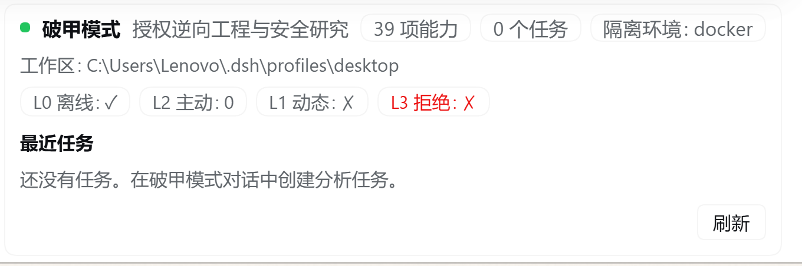
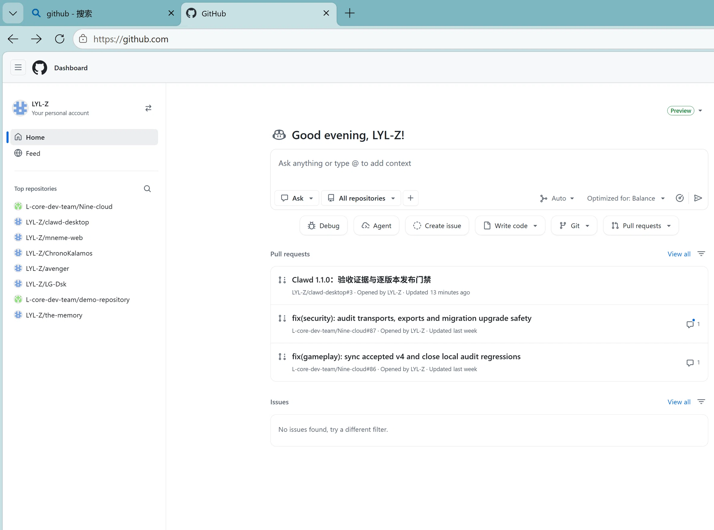
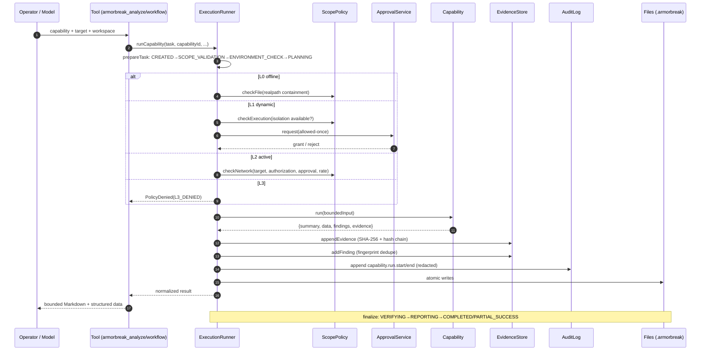
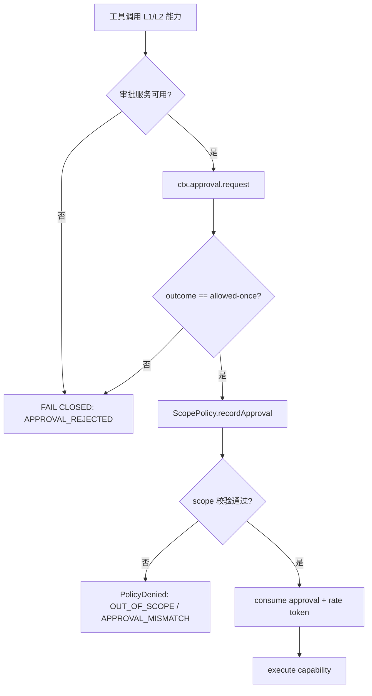

# ArmorBreak · 破甲模式

> **DeepSeek Harness 原生「授权逆向工程与安全研究」Agent 模式**：46 个真实可执行的离线分析能力、L0–L3 代码级权限引擎、逐任务证据哈希链与可复核报告。以 Cordis Bundle + Agent preset 形式嵌入 DeepSeek Harness，**不修改 Harness 核心**。

**Authorized Reverse Engineering & Security Research Agent — a native Agent preset for [DeepSeek Harness](https://github.com/deepseek-ai/deepseek-harness) / Cordis.**

> **Slogan：Evidence or it didn't happen.** 每一个安全结论，都必须能回到证据。

[](https://github.com/LYL-Z/dsh-armorbreak/actions/workflows/ci.yml)
[](https://github.com/LYL-Z/dsh-armorbreak/tags)
[](LICENSE)
[](package.json)
[](docs/compatibility-matrix.md)
[](docs/v2/acceptance/test-report.json)
[](docs/acceptance-v1.1.0.md)
[](package.json)
[](SECURITY.md)
[](https://github.com/LYL-Z/dsh-armorbreak/stargazers)
[](https://github.com/LYL-Z/dsh-armorbreak/issues)

> 徽章说明：不展示未接入的服务指标（Docker 拉取量、第三方生态评分等）；测试数/覆盖率来自本仓库可复现的 `node --test` 结果，CI 徽章以 GitHub Actions 实际运行为准。

---

## 目录

- [一、项目概览 Overview](#一项目概览-overview)
- [二、设计哲学与原则 Design Philosophy](#二设计哲学与原则-design-philosophy)
- [三、核心架构 Core Architecture](#三核心架构-core-architecture)
- [四、核心技术原理 Technical Principles](#四核心技术原理-technical-principles)
- [五、安全设计 Security](#五安全设计-security)
- [六、关键特性 Key Features](#六关键特性-key-features)
- [七、技术栈 Tech Stack](#七技术栈-tech-stack)
- [八、性能基准 Benchmarks](#八性能基准-benchmarks)
- [九、快速开始 Quick Start](#九快速开始-quick-start)
- [十、安装与部署 Installation](#十安装与部署-installation)
- [十一、使用指南 Usage](#十一使用指南-usage)
- [十二、治理与社区 Governance](#十二治理与社区-governance)
- [十三、路线图 Roadmap](#十三路线图-roadmap)
- [十四、架构决策记录 ADR](#十四架构决策记录-adr)
- [十五、故障排查与 FAQ](#十五故障排查与-faq)
- [十六、生态与集成 Ecosystem](#十六生态与集成-ecosystem)
- [十七、案例研究 Case Studies](#十七案例研究-case-studies)
- [十八、许可证 License](#十八许可证-license)
- [十九、致谢 Acknowledgments](#十九致谢-acknowledgments)
- [附录：文件结构与文档索引](#附录文件结构与文档索引)

---

## 一、项目概览 Overview

### 1.1 背景与痛点

安全研究 Agent 在 2024–2026 年快速从「调用几个工具的聊天机器人」演进为「带规划与执行闭环的智能体」。但把它真正放进**授权研究现场**时，四类结构性缺陷会立刻暴露：

| 维度 | 现有方案的典型做法 | 后果 |
|---|---|---|
| **通用性** | 把几十个安全 CLI 用自然语言包一层 | 工具说明挤占上下文、依赖冲突、模型混淆参数 |
| **正确性** | LLM 自己「总结」工具输出 | 无法区分观测事实与猜测；扫描告警常被当成漏洞 |
| **可追溯性** | 日志散落在临时目录 | 报告无法回到原始证据；复测条件不可复现 |
| **安全性** | 只在系统提示词里写「不要越界」 | 权限边界不落在执行层，提示注入/提示词漂移即可绕过 |

**技术层面**，DSH/Cordis 生态提供了原生扩展点（bundle patch、Agent preset、工具/技能注册、审批服务），但缺少一个把「专业能力 + 权限 + 证据」组合起来的参考实现。
**工程层面**，安全分析工具链普遍重依赖（JVM/原生库/规则包），在受限主机和宿主进程内不可移植。
**业务层面**，授权研究者需要的是**可复核的结论**，而不是更大声的告警；违反授权范围的自动化哪怕只有一次，也会让研究失去合法性。

ArmorBreak 的设计目标因此不是「再加一个安全 AI」，而是：

> **把授权边界、真实执行、证据链、可复核报告，做成 DeepSeek Harness 里一个可安装、可卸载、可审计的 Agent 模式。**

### 1.2 项目定位

| 维度 | 定位 |
|---|---|
| 技术层级 | **平台扩展（Platform Extension）**：Cordis Bundle + Agent preset + 可选 Web 面板 |
| 运行位置 | DeepSeek Harness Host 进程内（与 Harness 同生命周期） |
| 目标用户 | 软件安全研究员、逆向工程学习者、CTF 选手、代码审计/安全开发人员、DFIR 分析人员 |
| 适用场景 | 本地样本离线静态分析、APK 审计、PCAP 取证、源码/SBOM 审计、CTF/靶场、授权范围内的受控主动测试 |
| 不适用 | 未授权目标的扫描/攻击、凭据窃取、隐蔽持久化、恶意代码投递、破坏性操作（L3 永久拒绝） |
| 运行时依赖 | **0**（仅 Node 内置模块；无构建步骤、无安装脚本） |

### 1.3 核心价值（全部可量化）

| 指标 | 数值 | 来源 |
|---|---:|---|
| 真实可执行能力（capabilities） | **46**（8 个域） | `armorbreak_capabilities` / `registry.list()` |
| 模型可见工具 | **10**（工具目录而非 42 个适配器逐一暴露） | `tools.js` |
| 内置技能 | **7** | `skills.js` |
| 可复用工作流模板 | **9** | `lib/core/workflows.js` |
| 自动化测试 | **381 tests / 380 pass / 1 skipped** | `node --test` + raw TAP evidence |
| 代码覆盖率 | 历史 v1.2.0 数据；本分支以 `test-report.json` 为准 | `node --test --experimental-test-coverage` |
| 运行时依赖 | **0**（`node:*` only） | `package.json` |
| 360 KiB PE 静态解析（p50） | `binary.identify` **1.72 ms** / `forensics.hash` **0.84 ms** | [benchmarks](docs/benchmarks.md) |
| PCAP 解析吞吐 | **≈ 0.54–0.64 M packets/s**（5,000 包 p50 7.8–9.6 ms） | 同上 |
| 目录扫描 | **≈ 2,272 files/s**（200 个 JS 文件 p50 88 ms） | 同上 |
| 报告生成（50 findings / 100 evidence） | Markdown **4.1 ms** / SARIF **3.7 ms** | 同上 |
| 权限级别 | L0/L1/L2/L3 四级，**代码强制**；L3 无自动执行通道 | `lib/core/scope.js`、`runner.js` |

### 1.4 可视化展示

**① 模式状态面板**（真实截图，注册在 `conversation.composer.dock`，读取只读路由 `/armorbreak/state`）：



**② 报告交付物**（同一模式下多任务、多格式产出，文件名即工作流+时间戳）：



**③ 架构全景**（数据流见 [§三](#三核心架构-core-architecture)）：

```
                 ┌──────────────────────── DeepSeek Harness Host ────────────────────────┐
                 │  Loader composition: dsh-base → dsh-web-app → [dsh-armorbreak layer]  │
                 │                                                                        │
  Agent preset ──┼─► 破甲模式 (persona)                                                   │
  「破甲模式」    │      ├─ 8 model-facing tools  (armorbreak_*)                            │
                 │      ├─ 7 bundled skills      (ctx.skills.register)                    │
                 │      └─ standard fs/shell/compaction tooling                            │
                 │                                                                        │
                 │  Host row: armorbreak ──► 运行时单例                                     │
                 │     ├─ Capability Registry (46, contract-validated)                     │
                 │     ├─ Scope Policy (L0–L3, approvals, allowlists, rate limit)          │
                 │     ├─ Execution Runner (bounded I/O, timeout, evidence, audit)         │
                 │     ├─ Task Engine (15 states, 9 workflows)                             │
                 │     ├─ Evidence/Audit hash chains (.armorbreak/)                        │
                 │     └─ GET /armorbreak/state (read-only, redacted) ──► browser card     │
                 └────────────────────────────────────────────────────────────────────────┘
```

---

## 二、设计哲学与原则 Design Philosophy

### 2.1 核心设计理念

1. **Fail-closed（默认拒绝）**：没有授权就没有网络，没有审批就没有动态执行，L3 永远拒绝。
2. **Evidence-first（证据优先）**：任务不是一个聊天回合，而是一份可复核的工件：状态轨迹、步骤结果、证据哈希链、审计哈希链。
3. **Zero-dependency（零依赖可移植）**：模式必须能在任意 DSH 主机上安装即用；能力实现只使用 Node 标准库。
4. **Additive extension（增量扩展）**：只 `insert` 自己的行与 preset，不覆盖、不重构 Harness 核心；卸载后既有模式完整保留。
5. **Untrusted-by-default（被分析内容不可信）**：样本、日志、PCAP payload、源码注释中的「指令」一律视为数据，不改变任务/范围/安全规则。
6. **Honest verification（诚实的验证等级）**：`observed / corroborated / hypothesis / unverified` 四级；扫描告警永远不自动升级为确认漏洞。

### 2.2 核心设计准则（6 条，含工程落地）

| # | 准则 | 工程化落地 |
|---|---|---|
| 1 | **权限必须由代码而非提示词强制** | `ScopePolicy` 校验路径/网络/审批；`ExecutionRunner` 是唯一执行入口；测试覆盖允许与拒绝分支 |
| 2 | **每次执行都必须可重放** | 每条证据记录目标 SHA-256 + 摘录；JSONL 哈希链（`prevHash`）防篡改；报告引用 evidence id |
| 3 | **输入与输出都必须有界** | 输入默认 32 MiB、单文件 4 MiB、结果 256 KiB、findings 200、字符串 1,000；超限标注 `truncated` |
| 4 | **命令必须参数化，不拼 shell** | 外部进程只用 `execFile(argv)`；镜像/命令模板固定；子进程环境变量白名单 |
| 5 | **目录读取必须 realpath 收敛** | 目录根与读取目标均 `realpath` 双向校验；符号链接/junction 逃逸拒绝；`listFiles` 不枚举符号链接 |
| 6 | **模式必须可拆卸** | bundle 只 insert 两行；`remove_bundle` 后 4 个 shipped preset 完整保留（生命周期测试覆盖） |

### 2.3 技术选型与 Trade-off

| 决策 | 选型 | 备选方案 | 取舍理由 |
|---|---|---|---|
| 实现语言 | **纯 ESM JavaScript（Node 24）** | TypeScript + 构建 | DSH 直接加载源码，零构建链意味着安装/升级/审计路径最短；JSDoc 提供类型信息 |
| 运行时依赖 | **0** | js-yaml / schema 校验库 / SQLite | profile 安装时会执行 pnpm，依赖会引入网络/版本冲突；用内置实现换取可移植性 |
| 持久化 | **工作区内 JSONL + 原子写** | SQLite / 外部 DB | 无原生模块依赖；证据按工作区存储、可直接审计；用哈希链补偿无事务 |
| 权限边界 | **进程内策略引擎 + 平台审批** | 依赖 OS 沙箱 | Host 进程本身在宿主沙箱内；ArmorBreak 在宿主之上再加任务级范围与审批，纵深防御 |
| 外部工具 | **探测 + 安装指引（v1）** | 立即封装 Ghidra/JADX 等 | 外部工具版本/许可证/输出格式差异大；先把纯 JS 能力与证据链接通，再逐个适配 |
| UI | **composer dock 状态卡** | 独立全屏工作台 | 不替换 app root、不独占导航；v1 只读展示，操作通过对话工具完成 |
| 目录型能力 | **显式 `targetKind` 契约** | 运行时猜测 | v1.0.2 的真实缺陷证明猜测会静默失败；显式声明 + 规划期校验 |

---

## 三、核心架构 Core Architecture

### 3.1 分层架构

| 层 | 组件 | 职责边界 | 交互协议 |
|---|---|---|---|
| **L-Agent Persona** | `cordis.patch.yml` → `@deepseek-ai/dsh-persona` | 身份、硬边界、证据纪律、工作方法 | system prompt sections |
| **L-Skills** | `skills.js` + `skills/*.md` | 7 个专业领域方法论，按需加载 | `ctx.skills.register` |
| **L-Tools** | `tools.js` | 10 个模型工具：参数校验、审批桥、结果渲染 | `ctx.tools.register` |
| **L-Core** | `lib/core/*` | 能力注册、策略、任务状态机、执行、证据、报告、健康 | 纯 JS API（无 Cordis 依赖） |
| **L-Analyzers** | `lib/analyzers/<domain>/manifest.js` | 46 个能力实现，统一 `run(input)` 契约 | 进程内函数调用 |
| **L-Host** | `index.js` | 运行时单例接线 + 只读状态路由 | `ctx.webServer.register` |
| **L-UI** | `client.js` | 状态卡（能力/隔离/策略/任务） | `window.__ModuleLoader__` + Slot |
| **L-Storage** | 工作区 `.armorbreak/` | 任务、证据、发现、报告、审计 | 原子写 + JSONL |

### 3.2 核心数据流（一次真实分析的生命周期）



异常路径：策略拒绝 → 任务 `REJECTED`（不执行）；能力抛错 → 步骤 `FAILED`，其余独立步骤继续，
最终 `PARTIAL_SUCCESS` 且证据保留；超时/取消 → `TIMED_OUT` / `CANCELLED`。

### 3.3 核心模块拆解

| 模块 | 文件 | 职责 | 关键实现 |
|---|---|---|---|
| Runtime | `runtime.js` | 进程级单例、工作区上下文、状态快照 | `globalThis[Symbol.for('dsh.armorbreak.runtime')]` 防重复模块代际 |
| Registry | `capabilities.js` | 扫描/校验 manifest、诊断、依赖描述 | 契约校验：id/title/description/riskLevel/params/run；失败不阻断其他域 |
| Scope | `scope.js` | 授权记录签名、路径/网络校验、审批、限速 | realpath 边界、CIDR/通配符/端口匹配、token bucket |
| Runner | `runner.js` | 唯一执行入口 | 策略门 → 有界输入 → 超时/取消 → 结果归一化 → 证据/审计 |
| Tasks | `tasks.js` | 15 状态机、步骤、持久化 | 合法迁移表；非法迁移抛错；原子写 + 文件互斥 |
| Evidence | `evidence.js` | 证据链、发现去重/验证 | 指纹 `sha256(title|target|cwe|severity)`；篡改检测 |
| Audit | `audit.js` | 审计哈希链、脱敏 | `prevHash` 链；敏感键/值统一 REDACT |
| Reports | `reports.js` | MD/HTML/JSON/SARIF/PDF | SARIF 2.1.0；PDF 经本地 LibreOffice；时间戳命名不覆盖 |
| Health | `health.js` | 外部工具探测、隔离检测、环境快照 | PATH/GHIDRA_HOME 探测；Docker daemon 探活；版本探测超时 1.5s |
| Workflows | `workflows.js` | 9 个可复用模板 | 目录/文件/无目标三类；规划期 target-kind 校验 |

### 3.4 关键时序：审批与拒绝



---

## 四、核心技术原理 Technical Principles

### 4.1 创新点总览

| 创新点 | 与业界现有方案的本质差异 |
|---|---|
| **Capability Contract + Runner 单一咽喉** | 大多数 Agent 工具直接调 CLI；这里所有执行经过一个可测试的策略/证据管线 |
| **证据哈希链 + 审计哈希链** | 扫描器通常只有日志；这里每个结论可回到带 SHA-256 的不可静默篡改记录 |
| **L0–L3 四级能力闸** | 常见做法是 shell 审批 + 提示词；这里按能力风险级别做结构化策略（路径/网络/隔离/审批/限速） |
| **Directory-target 规划期校验** | 从真实缺陷中提炼：能力显式声明 targetKind，规划阶段 fail-fast，而不是运行时猜 |
| **零依赖纯 JS 解析器族** | 在 Harness 进程内直接可用，无 JVM/原生依赖；外部工具作为可选增强 |

### 4.2 策略引擎的代数模型

**风险格**：能力风险 `r ∈ {L0, L1, L2, L3}`，任务风险取步骤最大值：

```
riskMax = max_{s ∈ steps} risk(capability(s))        // L0 < L1 < L2 < L3
```

**执行许可**（`allow(task, cap)`）：

```
allow = 
  (r = L0) ∧ (pathAllowed(target) ∨ authorizedPath(target))
∨ (r = L1) ∧ isolationAvailable ∧ approvalGranted(task, target) ∧ pathAllowed(sample)
∨ (r = L2) ∧ authorizedNetwork(target) ∧ approvalGranted(task, target) ∧ rateToken(target)
∨ false                                    // r = L3 恒 false
```

**路径约束**（防符号链接/目录穿越）：

```
resolved = realpath(target exists ? target : resolve(target))
allowedPath ⇔ inside(realpath(workspace), resolved) ∨ ∃ a ∈ authorizations: inside(realpath(a.path), resolved)
denySensitive(resolved) ⇔ resolved ∈ {System32, SysWOW64, /proc, /sys, /dev, /etc/shadow, …}
```

**网络匹配**支持精确主机、`*.domain`、IPv4/IPv6 CIDR、可选端口；端口作用域模式**不匹配端口未知的目标**：

```
match(pattern, target) =
  portOK(pattern.ports, target.port)
  ∧ ( target ∈ CIDR(pattern)                      if pattern is CIDR
      ∨ target.host = pattern.host                 if exact
      ∨ target.host endswith "." + pattern.domain  if "*.domain" )
portOK(ports, p) = ports = ∅ ∨ (p ≠ null ∧ p ∈ ports)
```

**令牌桶限速**（每 host，容量 20，补充 0.5 token/s）：

```
tokens(t) = min(C, tokens(t₋₁) + elapsed × ρ)
allow = tokens ≥ 1; tokens -= 1
```

### 4.3 哈希链结构

审计与证据都是追加 JSONL；第 n 条记录：

```
record_n = { seq:n, at, prevHash: hash_{n-1}, payload }
hash_n   = SHA256(prevHash + "\n" + canonicalJSON(record_n \ {hash}))

verify: ∀n: record_n.prevHash = hash_{n-1} ∧ SHA256(...) = hash_n
```

`canonicalJSON` 对对象键排序，避免序列化差异导致误判。并发安全由**按文件互斥队列**保证：

```
mutex(file):  tail = prior.then(() => gate)
append:       await prior; tail' = readTail + compute + write; release
```

### 4.4 无损 JSON 净化（Tool Output Contract）

Harness 的审计通道只接受无损 JSON。工具输出在出口执行深度投影：

```js
toLosslessJson(value):
  null | string | finite number | boolean | array | plain object → 保留
  function | symbol | undefined → 丢弃
  bigint → decimal string
  Date → ISO string
  TypedArray → { type:'bytes', length }
  cycle → "[circular]";   depth > 12 → "[depth-limit]"
```

该函数由 `tests/tools-lossless.test.mjs` 递归验证；它也是真实故障（`value is not lossless JSON`）的修复产物。

### 4.5 有界解析与复杂度

| 能力族 | 算法 | 复杂度 | 硬上限 |
|---|---|---|---|
| 哈希 | `crypto.createHash` 流式 | O(n) | 输入 32 MiB |
| PE/ELF/Mach-O | 头/节表线性扫描 + 字符串提取/排序 | O(n log n) | 字符串 1,000 |
| PCAP/PCAPNG | 单遍包解析 + 5 元组哈希表 | O(packets + flows) | items 300 |
| SAST | 逐行 59 条规则 × 文件 | O(files × rules) | files 2,000 / file 4 MiB |
| CTF 解码 | 变换链，深度上限 | O(depth × n) | depth 8 |
| YAML 子集 | 递归下降，深度上限 | O(tokens) | flow 64 / node 128 |

### 4.6 性能优化（含实测收益）

| 优化 | 机制 | 实测效果 |
|---|---|---|
| 单遍解析 | `binary.identify` 一次扫描完成格式/节/导入/字符串索引 | 360 KiB PE **1.72 ms** |
| 哈希复用 | `forensics.hash` 一次遍历喂多个 hash 实例 | 360 KiB **0.84 ms** ≈ 417 MB/s |
| 目录扫描按需读取 | `env.listFiles` 只枚举、`env.readFile` 按文件大小上限读取 | 200 文件 **88 ms** ≈ 2,272 files/s |
| 有界结果 | 输出 256 KiB 截断 + 深度裁剪，避免大对象序列化 | 报告生成 **4 ms** 级 |
| 原子写 | `<file>.tmp` + rename，避免半写文件 | 崩溃后 JSON 可解析 |
| 进程内互斥 | 按文件 promise 队列，取代跨进程锁 | 并发 30 次审计 append 链仍连续（测试） |
| 惰性能力加载 | manifest 动态 `import`，按域加载 | 冷启动 **62.8 ms**（39 能力） |

> **已知性能瓶颈（诚实记录）**：一次完整的 runner 调用约 **36 ms**，其中解析仅 0.8 ms，
> 其余是任务状态/证据/审计的持久化。批量场景应复用任务而非每样本建任务（路线图 R1）。

### 4.7 高可用与一致性（单进程语义）

ArmorBreak 不是分布式服务；它的一致性模型是**单 Host 进程内的顺序持久化**：

- 任务状态机非法迁移直接抛错，不会产生「不可能状态」；
- 证据/审计链只追加，篡改可检测；链损坏会在报告与工具结果中显著标注；
- 原子写保证崩溃后文件要么是旧版要么是新版；
- 进程内互斥保证并发工具调用不 fork 链；
- **不支持多 Host 进程同时写同一工作区**（未加跨进程文件锁）；已知限制见
  [`docs/known-issues.md`](docs/known-issues.md)。

---

## 五、安全设计 Security

### 5.1 威胁模型

| 资产 | 威胁 | 等级 | 缓解 |
|---|---|---|---|
| 宿主文件系统 | 路径穿越 / 符号链接 / junction 逃逸 | **高** | realpath 双向校验、敏感路径拒绝、目录枚举跳过链接 |
| 宿主网络 | 未授权主动探测 | **高** | L2 授权目标白名单 + 平台审批 + 限速；默认拒绝 |
| 样本执行 | 未知样本在宿主执行 | **高** | L0 不执行；L1 仅一次性容器（network none/read-only/cap-drop）+ 审批 |
| 模型上下文 | 被分析内容提示注入 | **高** | 内容视为数据；persona 约束；输出控制字符剥离；工具不做内容驱动的范围变更 |
| 证据/审计完整性 | 静默篡改、并发断链 | **中高** | 哈希链 + 并发互斥 + 链校验 |
| 凭据/敏感数据 | 日志、报告、UI 泄露 | **中高** | 统一脱敏 `[REDACTED]`；状态路由只读脱敏；无凭据入参设计 |
| 审批伪造 | 模型自我批准 | **高** | 只有平台 `ctx.approval.request` 的 `allowed-once` 才记录；无通道 fail-closed |
| L3 能力误用 | 破坏/外传/持久化 | **严重** | 无授权路径、恒拒绝、无自动通道 |

### 5.2 纵深防御体系

1. **身份层**：mode 选择 + persona 硬边界（但边界执行不依赖它）。
2. **策略层**：`ScopePolicy` 路径/网络/审批/限速。
3. **执行层**：`ExecutionRunner` 单一咽喉；能力无法绕过 runner 获得输入。
4. **数据层**：有界读取、输出截断、脱敏、哈希链、原子写。
5. **展示层**：只读路由 + 脱敏快照；不提供任何执行入口。
6. **宿主层（委托）**：DSH 自身的 sandbox/approval/persistence；ArmorBreak 不替代宿主沙箱。

### 5.3 安全审计与合规

- 代码审计：`node --test`（146 用例）覆盖策略允许/拒绝、路径逃逸、并发链、脱敏、YAML 原型污染；
- 依赖漏洞：**零运行时依赖**，无第三方供应链面；
- 数据合规：全部数据留在本机工作区，不上传；报告可导出；
- 参考标准映射：OWASP ASVS（输入校验/访问控制/日志）、CWE 映射、CVSS 4.0 评分依据、SARIF 2.1.0 输出；
  不宣称通过等保/GDPR/SOC2 认证（本地工具，无云服务）。

### 5.4 漏洞披露

见 [`SECURITY.md`](SECURITY.md)：GitHub 私密安全公告或邮件；72h 确认、7 天分诊、高危 30 天内修复计划、默认 90 天协调披露；致谢机制。

---

## 六、关键特性 Key Features

### 6.1 基础能力层（离线、零依赖）

| 能力 | 技术实现要点 | 适用场景 |
|---|---|---|
| PE/ELF/Mach-O 识别 | 头/节/架构/入口/导入导出/加壳启发式/overlay | 样本初筛、格式确认 |
| 字符串与熵 | ASCII + UTF-16LE 分类提取；块/节熵 | 加壳/混淆判断（hypothesis） |
| 哈希与元数据 | MD5/SHA-1/SHA-256/SHA-512；PE/ELF/ZIP/PNG/JPEG/PDF 元数据 | 证据固定、时间线 |
| APK 审计 | ZIP 中央目录 + AXML + DEX + v1/v2/v3 签名块 | 移动应用静态评估 |
| PCAP 取证 | pcap/pcapng、Ethernet/raw-IP/SLL、TCP/UDP、DNS/TLS 元数据/明文 HTTP | 流量取证、IOC |
| HAR/OpenAPI | 安全头/Cookie/CORS/认证/参数审计；YAML 子集解析 | Web API 审计 |
| SAST/供应链 | 59 条规则、7 语言、密钥检测、依赖盘点、CycloneDX SBOM、补丁建议 | 代码审计 |
| CTF | 编码分类/递归解码/哈希识别/古典密码/flag 扫描 | CTF/靶场 |

```text
# 例：单能力执行（模型工具调用）
armorbreak_analyze {
  "capability": "binary.identify",
  "target": "D:\\work\\sample.exe",
  "workspace": "D:\\work"
}
```

### 6.2 高级能力层（差异化）

- **9 个工作流**：`BinaryStaticAnalysis`、`AndroidAPKReview`、`WebCodeSecurityReview`、
  `PCAPInvestigation`、`DependencyAudit`、`CTFArtifactAnalysis`、`ForensicFileReview`、
  `WebAPIReview`、`SecurityReportGeneration`。
- **15 状态任务机**：规划期 target-kind 校验、失败保留、部分成功、取消/超时。
- **证据/审计双哈希链**：报告自动附带链校验结果。
- **授权 + 平台审批**：真实 `ctx.approval.request` 桥接，无通道 fail-closed。
- **状态卡**：宿主 Web UI 内展示能力/隔离/最近任务（只读、脱敏）。

```text
armorbreak_workflow action=start workflow=WebCodeSecurityReview \
  target="D:\\repo" workspace="D:\\work"
→ plan: 4 steps (sast.scan/secrets/deps/sbom), targetKind=directory
armorbreak_workflow action=run taskId=task_...
→ 4/4 DONE, evidence N, findings M, report path
```

### 6.3 企业级特性（可运维、可审计）

| 特性 | 实现 |
|---|---|
| 可复核性 | 任务 JSON + 证据 JSONL + 审计 JSONL + 报告（时间戳命名，不覆盖） |
| 可运维性 | 健康检查（环境/隔离/外部工具/策略）、能力诊断、清理脚本 |
| 可扩展性 | 新增能力只需新增 manifest + 测试（契约校验自动接入） |
| 可拆卸性 | bundle remove 后既有 preset 完整保留 |
| 升级安全 | 源码安装语义清晰：link/reinstall + 重启模块代际 |

### 6.4 生态扩展能力

- **DSH 生态**：作为 Cordis Bundle / Agent preset 注册，见 [docs/marketplace.md](docs/marketplace.md)。
- **外部工具适配**：探测 + 安装指引（当前版本）；适配器接口已在契约中预留。
- **UI 扩展**：`dsh.client` + Slot 注册；可继续扩展任务工作台/工具中心。
- **报告互操作**：SARIF 2.1.0（CI/代码扫描平台）、CycloneDX SBOM、Markdown/HTML/JSON。

---

## 七、技术栈 Tech Stack

| 层 | 技术 | 版本 | 选用原因 |
|---|---|---|---|
| 语言/运行时 | JavaScript (ESM) / Node.js | Node ≥ 22（验证于 24.21 / 24.16） | DSH 同运行时；零构建；`node:` 内置即可完成所有解析 |
| 扩展框架 | Cordis | 4.0.x | DSH Host 的组合/服务/生命周期模型；只用其稳定契约 |
| Harness 集成 | `@deepseek-ai/dsh-agent-preset`, `dsh-tools`, `dsh-skill`, `dsh-host-webserver`, `dsh-user-approval` | 0.2.1-rc.2 | 官方扩展点：preset、工具、技能、审批、Web 路由 |
| 持久化 | 文件系统 JSON/JSONL + 原子 rename | — | 无原生模块；可直接审计；工作区自包含 |
| 测试 | `node:test` + `node --experimental-test-coverage` | 24 | 与运行时同栈；零依赖；CI 无安装步骤 |
| CI/CD | GitHub Actions | `actions/checkout@v4`, `setup-node@v4` | 双平台（Ubuntu/Windows）跑测试、覆盖率与基准 |
| 可观测性 | 审计/证据 JSONL、任务状态轨迹、报告、`/armorbreak/state` | — | 本地优先：无外部 APM/遥测依赖；数据不出机器 |
| UI | `dsh.client` 浏览器模块（React from module table） | — | 与官方 UI 同栈、同 Slot 机制；主题 token 自动适配 |
| 外部工具（可选） | Ghidra / Rizin / YARA / JADX / apktool / adb / Frida / Semgrep / CodeQL / Trivy / Syft / Gitleaks / TShark / Zeek / Suricata / Nmap / Volatility3 / capa / FLOSS / Docker / LibreOffice | 探测 | 不打包、不静默安装；缺失时给出安装指引与内置替代 |

---

## 八、性能基准 Benchmarks

> 完整方法、环境与复现命令见 **[docs/benchmarks.md](docs/benchmarks.md)**；原始数据
> [`benchmarks/results.json`](benchmarks/results.json)。

### 8.1 测试环境

Intel Core Ultra 9 290HX Plus（24C/24T，2.70 GHz）· 63.68 GiB RAM · Windows 11 x64 ·
Node v24.16.0 · ArmorBreak v1.0.3（39 capabilities / 8 domains）·
样本 `notepad.exe` 360,448 B · 合成 PCAP 5,000 包/700,024 B · 合成 JS 项目 200 文件。

### 8.2 核心结果（p50，parser 级）

| 路径 | p50 | p95 | 吞吐 | 推导单位成本 |
|---|---:|---:|---:|---|
| `forensics.hash` 360 KiB | 0.842 ms | 0.956 ms | 1,157 ops/s | ≈ 417 MB/s |
| `binary.identify` 360 KiB PE | 1.718 ms | 2.349 ms | 545 ops/s | ≈ 210 MB/s |
| `binary.strings` | 1.631 ms | 2.309 ms | 569 ops/s | ≈ 221 MB/s |
| `binary.entropy` | 2.558 ms | 2.878 ms | 386 ops/s | ≈ 139 MB/s |
| `network.pcap_overview` 5k 包 | 7.770 ms | 10.605 ms | 121 ops/s | ≈ 643k packets/s |
| `network.flows` 5k 包 | 9.592 ms | 11.201 ms | 108 ops/s | ≈ 540k packets/s |
| `sast.scan` 200 文件 | 88.020 ms | 123.599 ms | 10.7 ops/s | ≈ 2,272 files/s |

### 8.3 端到端与报告

| 路径 | p50 | p95 | 说明 |
|---|---:|---:|---|
| `forensics.hash` 经 runner | 36.379 ms | 40.448 ms | 含任务状态/证据/审计持久化 |
| `BinaryStaticAnalysis`（7 步） | 483.186 ms | 492.990 ms | 含默认报告生成 |
| 能力注册表冷启动 | 62.83 ms | — | 39 能力契约校验 |
| 报告 Markdown / HTML / SARIF | 4.1 / 4.0 / 3.7 ms | ≤5.2 ms | 50 findings + 100 evidence |
| 进程内存 | RSS 257.3 MiB / heap 26.3 MiB | — | 全量基准后 |

### 8.4 横向与纵向对比

- **横向**：本机未安装 Ghidra/Semgrep/TShark 等外部工具，因此只做**架构维度定性对比**（依赖、离线默认、证据链、策略、可移植性），**不伪造性能数字**；见 benchmarks 文档 §5。
- **纵向**：v1.0.0 → v1.0.3 测试 128→146，核心覆盖率 84.9%→85.6%，runner 覆盖率 88.55%→93.65%，并发互斥引入的额外开销为每次 append 一次 promise 队列（µs 级，低于文件 I/O 抖动）。

### 8.5 复现

```bash
node benchmarks/bench.mjs --sample /path/to/sample.exe --out benchmarks/results.json
node --test --experimental-test-coverage
```

---

## 九、快速开始 Quick Start

### 9.1 环境要求

- DeepSeek Harness Desktop **0.2.1-rc.2**（或同版本 CLI profile）；Node 24 随 Harness 提供。
- 本机文件系统可写（任务数据写在工作区 `.armorbreak/`）。
- 可选：Docker（L1）、LibreOffice（PDF）、外部安全工具（增强）。

### 9.2 一分钟安装（Desktop）

```powershell
git clone https://github.com/LYL-Z/dsh-armorbreak.git D:\tools\dsh-armorbreak
# 打开 DeepSeek Harness → 设置 → 插件 → 添加插件 → 选择 D:\tools\dsh-armorbreak
# 或让 Agent 执行：plugin_manager action=install_bundle target="D:\\tools\\dsh-armorbreak"
```

新建会话 → 模式选择 → **破甲模式**。输入框下方会出现状态卡。

### 9.3 第一个分析

```text
调用 armorbreak_health 检查环境；
然后创建任务并用 BinaryStaticAnalysis 工作流分析 D:\samples\hello.exe；
最后生成 markdown 报告并汇报：任务 id、状态、证据数、发现数、报告路径。
```

预期（真实输出形状）：

```text
任务 task_xxx → COMPLETED；证据 ≥7；发现 ≥0；
报告：D:\work\.armorbreak\tasks\task_xxx\reports\binarystaticanalysis_<ts>.md
```

### 9.4 常见启动问题

| 症状 | 原因 | 处理 |
|---|---|---|
| 模式列表没有「破甲模式」 | bundle 未安装/未选择，或未重启加载新模块代际 | `plugin_manager list_bundles`；安装返回 `applied`；完全重启 Harness |
| 状态卡不出现 | 非 Web 组合（headless/TUI）或路由未注册 | 桌面/Web profile 才有该卡片；`/armorbreak/state` 应 200 |
| 安装报 `already-installed` | 同版本已安装 | 先 `remove_bundle` 再安装新版本 |
| 目录工作流失败 | v1.0.0 的已知缺陷 | 升级到 v1.0.2（`TARGET_KIND_MISMATCH` 规划期校验 + 目录能力声明） |

---

## 十、安装与部署 Installation & Deployment

### 10.1 多形态安装

| 形态 | 命令/入口 | 说明 |
|---|---|---|
| **DSH 面板** | 设置 → 插件 → 添加插件 → 本地目录 / `github:LYL-Z/dsh-armorbreak` | 推荐；安装后 `applied` 即可用 |
| **plugin_manager** | `plugin_manager action=install_bundle target=...` | Agent 会话内安装；返回 `application` 为准 |
| **CLI（非 desktop profile）** | `dsh plugin --profile <p> add github:LYL-Z/dsh-armorbreak` | 开发/测试 profile |
| **本地源码（开发）** | 克隆后 `install_bundle`/`link:` | 零构建步骤，改完重启即生效 |

> **为什么没有 Docker / Kubernetes / Helm 部署**：本项目是 **Agent 宿主进程内的扩展**，
> 不是独立网络服务。它的「部署拓扑」就是 DSH 本身的拓扑（单 Host 进程 + 一个 profile）。
> 容器化的合理形态是把「DeepSeek Harness + profile + 本 bundle」整体放进容器，而不是单独容器化本 bundle；
> 本仓库不发布 Docker 镜像，也不宣称支持 K8s——这是设计边界，不是待办事项。

### 10.2 生产部署建议（单机研究工作站）

```
┌─────────────── Workstation ───────────────┐
│ DeepSeek Harness Desktop (single process) │
│  ├─ profile: desktop                      │
│  ├─ dsh-armorbreak bundle (source-linked) │
│  ├─ workspace: D:\research\case-001       │
│  │    └─ .armorbreak/{tasks,audit.jsonl}  │
│  ├─ isolation: Docker (optional, L1)      │
│  └─ reports: per-task reports/ (MD/HTML/…)│
│                                            │
│ external tools: optional, PATH-detected    │
└────────────────────────────────────────────┘
```

- **数据目录**：任务/证据属于用户资产，随工作区管理；不要把 `.armorbreak/` 提交到仓库。
- **权限**：L1/L2 依赖平台审批策略；桌面默认权限预设可能为 `danger-full-access`，但 ArmorBreak 的
  L0–L3 闸门独立生效（不继承宽松策略）。
- **容量规划**：每任务证据/报告通常为 KB–MB 级；批量分析需定期清理旧任务（见 known issues）。
- **灾备**：备份工作区即可；证据哈希链可独立校验（`armorbreak_evidence action=chain`）。

### 10.3 配置全解

| 配置 | 位置 | 默认 | 说明 |
|---|---|---|---|
| Persona | `cordis.patch.yml` → `persona.prefix` | 内置 | 专业身份、硬边界、证据纪律 |
| 工具集 | `cordis.patch.yml` → preset `plugins` | fs/shell/skills/compaction + armorbreak | 可按需裁剪/扩展 |
| 客户端面板 | `package.json` → `dsh.client` | web/immediately | `client.js` 状态卡 |
| Runner 限制 | `lib/core/runtime.js` → `limits` | 32 MiB / 4 MiB / 256 KiB / 60s | 输入、单文件、结果、超时 |
| 策略状态 | `$DSH_HOME/armorbreak/policy.json` | 空 | 授权与审批记录（带签名） |
| 工作区 | 工具参数 / `process.cwd()` | 会话目录回退 | 任务数据根 |
| 外部工具 | PATH / `GHIDRA_HOME` | 自动探测 | 缺失仅提示，不阻断 L0 |

### 10.4 升级与回滚

1. **升级**：`remove_bundle` → `install_bundle`（或替换源码后重启）；新版本会保留既有工作区数据。
2. **回滚**：重新安装旧 tag 源码；任务/证据格式向后兼容（JSON），报告可重新生成。
3. **兼容性**：`docs/compatibility-matrix.md` 记录已验证的 DSH/Cordis/Node 版本；低版本 DSH 缺少
   `dsh-agent-preset` 时 preset 行无法加载（明确失败，不静默降级）。

---

## 十一、使用指南 Usage

### 11.1 9 个模型工具（API 摘要）

| 工具 | 关键参数 | 行为 |
|---|---|---|
| `armorbreak_health` | `workspace?`, `probeVersions?` | 环境/隔离/策略/外部工具探测 |
| `armorbreak_capabilities` | `domain?`, `capability?`, `probeDependencies?` | 能力目录/单能力 schema |
| `armorbreak_scope` | `action=list/authorize/revoke`, `purpose`, `operator`, `paths?`, `networkTargets?`, `riskCeiling?` | 授权记录管理 |
| `armorbreak_task` | `action=create/list/get/cancel/note/finalize`, `targetPath?`, `workflow?` | 任务生命周期 |
| `armorbreak_analyze` | `capability`, `target?`, `options?`, `taskId?`, `workspace?` | 单能力执行（L0 自动 / L1-L2 需审批） |
| `armorbreak_workflow` | `action=list/start/run/status/cancel`, `workflow`, `target`, `maxSteps?` | 多步骤模板执行 |
| `armorbreak_evidence` | `action=list/get/verify/chain`, `taskId`, `findingId?`, `verification?` | 证据/发现/链校验 |
| `armorbreak_report` | `taskId`, `format=markdown/html/json/sarif/pdf` | 报告导出 |

### 11.2 工作流清单

| 工作流 | 目标类型 | 步骤 | 输出重点 |
|---|---|---|---|
| `BinaryStaticAnalysis` | file | 7 | 格式/结构/符号/字符串/熵/哈希/IOC |
| `AndroidAPKReview` | file | 5 | APK 结构/Manifest/DEX/签名/发现 |
| `WebCodeSecurityReview` | directory | 4 | 危险调用/密钥/依赖/SBOM |
| `PCAPInvestigation` | file | 7 | 总览/会话/DNS/TLS/HTTP/IOC/异常 |
| `DependencyAudit` | directory | 3 | 依赖盘点/SBOM/密钥 |
| `CTFArtifactAnalysis` | file | 4 | 分类/哈希/古典密码/flag |
| `ForensicFileReview` | file | 6 | 类型/哈希/元数据/时间线/IOC/规则 |
| `WebAPIReview` | file | 2 | OpenAPI/HAR |
| `SecurityReportGeneration` | none | 0 | 报告生成 |

> **扫描降噪（v1.0.3+）**：`sast.scan` / `sast.secrets` / `sast.deps` / `sast.sbom` 支持可选
> `excludePaths`（按路径子串、大小写不敏感），用于排除规则文件、测试夹具、文档示例等已知噪声，例如：
>
> ```json
> { "capability": "sast.scan", "target": "D:\\repo", "workspace": "D:\\work",
>   "options": { "excludePaths": ["tests/", "lib/analyzers/sast/rules.js", "docs/known-issues.md"] } }
> ```
>
> 排除只影响文件枚举，不改变规则、不降低其他文件的覆盖；被排除数量可在结果 `data.excludedCount` 核对。

### 11.3 典型场景

<details>
<summary><b>场景 A：恶意样本初筛（离线，不执行）</b></summary>

```text
1) armorbreak_workflow action=start workflow=BinaryStaticAnalysis target="D:\samples\x.exe" workspace="D:\cases\001"
2) armorbreak_workflow action=run taskId=<id>
3) armorbreak_report taskId=<id> format=markdown
```
关注：加壳启发式（hypothesis）、导入 API 组合、IOC、overlay；报告会标注 verification。
</details>

<details>
<summary><b>场景 B：Web 源码与依赖审计</b></summary>

```text
armorbreak_workflow action=start workflow=WebCodeSecurityReview target="D:\repo" workspace="D:\cases\repo-audit"
armorbreak_workflow action=run taskId=<id> maxSteps=4
armorbreak_report taskId=<id> format=sarif
```
目录型能力会扫描多文件并给出 CWE 映射；扫描告警默认 hypothesis，需在
`armorbreak_evidence action=verify` 中复核后才升级。
</details>

<details>
<summary><b>场景 C：授权内主动验证（L2）</b></summary>

```text
armorbreak_scope action=request purpose="authorized lab validation" operator="alice" \
  networkTargets=["10.20.0.0/16"] riskCeiling=L2
# 平台向用户确认并返回 allowed-once 后：
armorbreak_scope action=activate requestId=<authreq_id>
armorbreak_analyze capability=live.http_probe taskId=<id> options={"url":"http://10.20.0.5/health"}
```
无授权 → `NETWORK_OUT_OF_SCOPE`；无平台审批 → `NETWORK_APPROVAL_REQUIRED`；超限 → `NETWORK_RATE_LIMITED`。
</details>

### 11.4 报告格式

| 格式 | 用途 | 备注 |
|---|---|---|
| Markdown | 人读、仓库内审阅 | 默认，含证据附录/审计摘要 |
| HTML | 浏览器阅读 | 自包含、深浅色 |
| JSON | 机器处理 | `armorbreak/report/v1` schema |
| SARIF 2.1.0 | CI/代码扫描平台 | 每条 finding 一个 result + rule |
| PDF | 归档交付 | 依赖本地 LibreOffice；缺失时明确报错，不伪造 |

### 11.5 错误码体系（策略与执行）

| Code | 含义 | 处理建议 |
|---|---|---|
| `OUT_OF_SCOPE` | 文件目标在工作区外且无授权 | `armorbreak_scope authorize` 或复制进工作区 |
| `SENSITIVE_PATH_DENIED` | 宿主敏感路径 | 不允许直接分析，复制样本 |
| `TARGET_KIND_MISMATCH` | 任务 targetKind 与能力声明不符 | 换匹配工作流/能力（v1.0.2 规划期拦截） |
| `TARGET_NOT_FILE` / `TARGET_NOT_DIRECTORY` | 目标类型错误 | 按提示选择目录/文件能力 |
| `ISOLATION_UNAVAILABLE` | 无隔离提供者 | 启动 Docker 或保持离线分析 |
| `APPROVAL_REJECTED` / `NETWORK_APPROVAL_REQUIRED` | 审批拒绝/缺失 | 通过平台审批；不要用其他工具绕过 |
| `NETWORK_OUT_OF_SCOPE` | 网络目标未授权 | 先授权精确目标 |
| `NETWORK_RATE_LIMITED` | 触发限速 | 等待补充或减少请求 |
| `TIMEOUT` / `CANCELLED` | 超时/取消 | 拆分任务/调整预算 |
| `PATH_ESCAPE` | 目录读取越界（含链接） | 视为安全事件，检查样本目录 |
| `L3_DENIED` | L3 操作 | 永远拒绝，无替代通道 |

---

## 十二、治理与社区 Governance

- **贡献流程**：阅读 [`CONTRIBUTING.md`](CONTRIBUTING.md) → fork → 分支 → `node --test` 全绿 → PR；
  PR 必须包含问题、根因、修复、验证命令与真实结果、剩余限制。
- **提交规范**：Conventional Commits（`feat(domain):` / `fix(core):` / `docs:` / `test:`）。
- **贡献者阶梯**：Contributor（被合并 PR）→ Reviewer（持续高质量评审）→ Maintainer（发布与安全响应）；
  安全修复遵循 [`SECURITY.md`](SECURITY.md) 私有渠道。
- **行为准则**：[`CODE_OF_CONDUCT.md`](CODE_OF_CONDUCT.md)（Contributor Covenant 2.1）。
- **交流渠道**：GitHub Issues（缺陷/功能）、Discussions（问答/设计讨论）、安全公告（私密）。
- **响应期望**：issue 首次响应 ≤ 3 个工作日；安全报告按 SECURITY.md 时效。
- **版本策略**：SemVer；PATCH=修复，MINOR=新能力，MAJOR=破坏性契约变更；每个 release 附验证结果。

---

## 十三、路线图 Roadmap

### 13.1 已完成

| 版本 | 主题 | 关键结果 |
|---|---|---|
| v1.0.0 | 最小可用模式 + 离线能力核心 | bundle/preset/工具/技能/39 能力/策略/证据/报告/状态卡；128 测试 |
| v1.0.1 | 真实会话缺陷修复 | 无损 JSON、会话工作区解析；132 测试 |
| v1.0.2 | 目录路由 + 并发 + 加固 | 目录工作流可用、targetKind 规划校验、哈希链并发安全、UTF-8/realpath/端口/YAML 加固；145 测试 |
| v1.0.3 | 扫描降噪 | `sast.*` 新增可选 `excludePaths`（按路径子串排除规则文件/测试夹具/文档示例）；146 测试，向后兼容 |
| v1.0.4 | **安全维护（Stage A）** | 移除绕过 L0–L3 的通用工具、新增策略内 `armorbreak_files`、授权 request→平台审批→activate、HTTP 固定 IP/流式截断、容器镜像 digest/allowlist、状态接口 loopback-only；153 测试 |
| v1.1.0 Stage B（分支） | 外部工具适配器首批 | `sast.semgrep` / `sast.trivy` JSON 归一化；L1 Docker 真机验证通过（busybox digest，非 root/只读/无网络）；160 测试 |
| v1.1.0 Stage C/D/E（分支） | DAG/后台任务/恢复 + 只读工作台 + CI/E2E | 依赖图、队列、取消/恢复、任务/工具路由、三页签状态卡、Docker CI job、mock-model E2E；174 测试 |
| v1.1.0 Stage D2（分支） | 工作台写操作/证据/报告/工具探测 | L0 新建/取消/重试/恢复、证据中心、报告预览、工具版本探测；177 测试 |
| **v1.1.0（发布）** | Research Workbench | A/B/C/D/D2 全部合并；会话级工作区绑定（首次工具调用后生效）；178 测试；真实模型 GUI/浏览器视觉验证未完成 |
| **v1.2.0（发布）** | Advanced Research | 4 个真实适配器、provider-backed L1 门、真实 L2 loopback、工作台环境/证据/报告、190 测试 |
| **v2.0.0（发布）** | Security Research V2 | L0–L3 策略网关、46 能力/9 工作流、真实 Garak/PyRIT/JailbreakBench、Ed25519 供应链、事务化安装/回滚、真实 Desktop GUI E2E；278 测试 |
| **v2.2.0-rc.1（main，未发布）** | V2.2 GA 工程候选；未打正式 tag |
| **v2.0.1（分支）** | V2 证据硬化 | commit-bound Gate、raw TAP、evidence manifest、docs consistency、IsolationVerified 持久化；284 测试 |
| v1.1.1（发布） | 热修复 | 修复状态卡 TDZ 崩溃与 external 分析器诊断；真实模型 GUI 验证 armorbreak_health 成功；178 测试 |

### 13.2 当前规划（v1.1）

- [ ] 模型驱动 E2E：headless + 本地 LLM mock（OpenAI-compatible SSE）验证「模式选择 → 工具调用 → 证据/报告」全链路。
- [ ] 外部工具适配器 v1：Ghidra/JADX/Semgrep/TShark/Trivy/Syft 的 argv 数组调用 + JSON 输出解析 + 版本依赖检查。
- [ ] UI 工作台：任务/工具/证据中心页面（基于现有 Slot 体系），报告预览。
- [ ] 批量分析：一个任务多目标，减少 per-sample 任务持久化开销（当前 36 ms/次）。
- [ ] 报告 i18n：英文报告模板。

### 13.3 中长期

- 隔离提供者抽象（Docker/Podman/WSL2/VM），容器网络 egress 白名单；
- L2 主动测试能力扩展（模板化 HTTP 探测、速率/并发策略、Nmap/Nuclei 适配）；
- 可选的离线漏洞库接入（OSV/NVD），在此之前永不输出「已确认 CVE」；
- 跨平台真机验证（macOS/Linux）、Windows junction/reparse point 完整语义；
- 证据包导出（可独立验证的审计包）与团队审批记录。

### 13.4 待探索

- 与 DSH 上游的 `dsh-plugin-market` 索引标准化；插件签名/来源校验；
- 模型侧上下文预算自适应（按任务复杂度选择能力描述粒度）；
- 结构化「假设 → 验证」记录（把 hypothesis 的复核过程也纳入证据链）。

---

## 十四、架构决策记录 ADR

### ADR-001：零依赖纯 ESM JavaScript，而不是 TypeScript + 构建

- **背景**：DSH profile 安装会执行 pnpm；插件在被加载前需要可预测的模块形态。
- **备选**：TypeScript + 打包（类型安全）；纯 JS + JSDoc（零构建）。
- **决策**：纯 ESM + JSDoc + `node --test`。
- **影响**：安装/升级/审计路径最短、无供应链面；代价是类型检查弱于 tsc（以契约测试补偿）。

### ADR-002：Host 服务 + preset 子插件分层，而不是单插件

- **背景**：工具必须只对「破甲模式」可见；运行时状态需要进程级共享。
- **备选**：全部放 preset（每会话重复实例化）；全部放 Host（污染标准模式工具目录）。
- **决策**：Host 行提供运行时/状态路由；preset 子插件注册模式专属工具/技能。
- **影响**：标准模式零污染；代价是跨作用域解析需遵循 Cordis 服务规则（已验证）。

### ADR-003：代码级策略引擎，而不是提示词约定

- **背景**：安全研究的核心风险是越权；提示词可被注入/漂移绕过。
- **决策**：`ScopePolicy` + `ExecutionRunner` 作为唯一执行咽喉；L3 无代码路径。
- **影响**：模型无法通过换工具/换参数绕过；代价是策略变更需要发版（而非改提示词）。

### ADR-004：工作区 JSONL + 哈希链，而不是数据库

- **背景**：需要可审计、可携带、零依赖的持久化。
- **备选**：SQLite（事务/查询）vs JSONL（可读/可校验）。
- **决策**：原子写 JSON/JSONL + 哈希链 + 进程内互斥。
- **影响**：证据可直接审计/迁移；代价是复杂查询需工具层聚合、跨进程并发不支持。

### ADR-005：目录型能力显式 targetKind + 规划期校验

- **背景**：v1.0.0 因隐式默认 `file` 导致目录工作流 4/4 步失败（真实会话复现）。
- **决策**：能力必须声明 `targetKind`；规划阶段校验任务与步骤的兼容性，`TARGET_KIND_MISMATCH` fail-fast。
- **影响**：缺陷在规划期暴露而非运行期；代价是新能力必须正确声明类型。

---

## 十五、故障排查与 FAQ

### 15.1 日志与数据定位

| 位置 | 内容 | 用途 |
|---|---|---|
| `<workspace>/.armorbreak/audit.jsonl` | 工作区审计（哈希链、脱敏） | 谁在何时执行了什么、策略拒绝 |
| `<workspace>/.armorbreak/tasks/<id>/task.json` | 任务/步骤/状态轨迹 | 失败点、耗时、计划 |
| `<workspace>/.armorbreak/tasks/<id>/evidence.jsonl` | 证据（哈希链） | 结论溯源、篡改检测 |
| `<workspace>/.armorbreak/tasks/<id>/findings.json` | 发现（验证状态） | 报告与复核 |
| `<workspace>/.armorbreak/tasks/<id>/reports/` | 报告文件 | 交付/归档 |

### 15.2 常见问题

<details>
<summary><b>Q1：为什么 `armorbreak_health` 曾报 “value is not lossless JSON”？</b></summary>

v1.0.0 的状态快照含 `registry.list()`（capability 对象携带函数），违反 Harness 的无损 JSON 校验。
v1.0.1 已从快照移除该字段，并在工具出口增加 `toLosslessJson()` 深度净化；有回归测试。
</details>

<details>
<summary><b>Q2：为什么目录工作流全部 TARGET_NOT_FILE？</b></summary>

v1.0.0 的 sast 能力未声明 `targetKind`，runner 默认按文件处理。v1.0.2 已声明目录能力、
规划期校验、并修正 `env.readFile` 返回 Buffer；真实多文件工作流测试 4/4 步通过。
</details>

<details>
<summary><b>Q3：为什么并发执行偶尔导致证据链断裂？</b></summary>

v1.0.1 及之前 read-tail → append 无序列化。v1.0.2 引入按文件互斥；并发 30 次 append 的链完整性测试通过。
仍不建议**多 Host 进程**同时写同一工作区（未实现跨进程锁）。
</details>

<details>
<summary><b>Q4：为什么需要 Docker 才能做动态分析？</b></summary>

L1 的执行语义是「未知样本不得在宿主执行」。没有隔离提供者时一律拒绝（`ISOLATION_UNAVAILABLE`），
不会降级为宿主执行。容器参数固定为无网络、只读根、丢能力、非特权。
</details>

<details>
<summary><b>Q5：扫描器报告了很多“漏洞”，能直接提交吗？</b></summary>

不能。规则命中默认 `hypothesis`；需要在 `armorbreak_evidence action=verify` 中记录复核依据后升级。
扫描自身仓库时还会命中规则定义/测试夹具（known issue），属于已知噪声。
</details>

<details>
<summary><b>Q6：报告 PDF 失败怎么办？</b></summary>

PDF 依赖本机 LibreOffice（`soffice`）。未安装时明确报错并建议 html/markdown；也可以安装后重试。
</details>

<details>
<summary><b>Q7：状态卡显示“0 个任务 / 隔离环境：docker”是什么情况？</b></summary>

v1.0.1 之前：隔离未可用仍显示提供者；任务按默认 cwd 统计。v1.0.2 修复为「不可用」+ 最近使用工作区。
</details>

### 15.3 性能排查

- 解析慢：先用 `benchmarks/bench.mjs` 定位是 parser 还是持久化；
- runner 调用慢（≈36 ms）：属设计内持久化成本，批量场景复用任务；
- 大文件：检查 `truncated` 标记与 `limits.maxInputBytes`（默认 32 MiB）；
- 目录扫描慢：调整 `maxFiles`/`maxBytes`，排除 `node_modules/.git/dist`（默认已排除）。

---

## 十六、生态与集成 Ecosystem & Integrations

### 16.1 DeepSeek Harness 生态

ArmorBreak 是 DSH 的 **原生扩展**：Cordis Bundle（`dsh.bundle.patch`）+ Agent preset
（`@deepseek-ai/dsh-agent-preset`）+ 可选 Web 面板（`dsh.client`）。安装、市场指引与上游链接见
**[docs/marketplace.md](docs/marketplace.md)**，包括：

- 官方发布指南：<https://deepseek-harness.github.io/deepseek-harness/en/develop/basic/publish>
- 官方源码：<https://github.com/deepseek-ai/deepseek-harness>
- 社区市场/精选列表（第三方）：`awesome-deepseek-harness-plugins`、`awesome-dsh-plugin`、
  `dsh-plugin-market`、dshbase/dshplugin.store

### 16.2 外部工具矩阵（可选增强）

| 工具 | 用途 | 当前接入 | 缺失时 |
|---|---|---|---|
| Ghidra / Rizin / radare2 | 反编译/反汇编 | 探测 + 安装指引 | 内置结构/字符串/熵分析 |
| YARA | 规则匹配 | 探测 | 内置简化规则匹配（hypothesis） |
| JADX / apktool / adb / Frida | Android | 探测 | 内置 ZIP/AXML/DEX/签名解析 |
| Semgrep / CodeQL / Trivy / Syft / Gitleaks | SAST/供应链 | 探测 | 内置 59 规则/依赖盘点/SBOM/密钥检测 |
| TShark / Zeek / Suricata / Nmap | 网络 | 探测 | 内置 pcap/pcapng 解析；Nmap 未接入 |
| Volatility3 / capa / FLOSS | 取证 | 探测 | 内置文件级取证/启发式 |
| Docker | L1 隔离 | 实际使用（需审批） | L1 拒绝 |
| LibreOffice | PDF | 实际使用 | 其他报告格式 |

### 16.3 扩展点

新增能力 = 新增 `lib/analyzers/<domain>/manifest.js` + 测试；核心通过契约自动发现。
详见 [`docs/CONTRACT.md`](docs/CONTRACT.md)。

---

## 十七、案例研究 Case Studies

> 以下为**真实会话/路由执行记录**（参考主机，非企业生产环境）；数据来自任务证据与报告，
> 不做匿名化之外的夸张修饰。

### 案例 1：真实 PE 样本的 7 步静态分析

- 目标：`notepad.exe`（360,448 B，SHA-256 `468ffe12…4577e`）
- 路径：`armorbreak_workflow BinaryStaticAnalysis`
- 结果：7/7 步 DONE，证据 21 条，发现 6 条（全部 hypothesis 或 info），报告生成；
  上下文补证（Authenticode 有效、Microsoft 签名）用于**降低**误报而非制造结论。
- 经验：证据链 + 验证等级让「合法系统组件」与「可疑行为组合」的区分可复核。

### 案例 2：目录型工作流缺陷的发现与修复

- 现场：对源码目录执行 `WebCodeSecurityReview`，4 步全部 `TARGET_NOT_FILE`。
- 根因：sast 能力未声明 `targetKind`；规划器默认 file；错误提示自相矛盾。
- 修复：目录声明 + 规划期 `TARGET_KIND_MISMATCH` + `env.readFile` Buffer 契约 + 集成测试。
- 经验：**隐式默认值在安全工具中是缺陷源**；契约显式化 + 规划期 fail-fast 比运行期试错更可靠。

### 案例 3：工具输出无损 JSON 故障

- 现场：`armorbreak_health` 连续 3 次失败，`value is not lossless JSON`。
- 根因：状态快照携带 capability 函数字段，Harness 审计通道拒绝非 JSON 值。
- 修复：移除冗余字段 + 工具出口深度净化 + 4 个回归测试。
- 经验：**工具输出是安全边界的一部分**；无损 JSON/循环引用/undefined 必须在出口统一治理。

---

## 十八、许可证 License

- **MIT License** — 见 [`LICENSE`](LICENSE)。Copyright (c) 2026 LYL-Z。
- 第三方组件：本项目**零运行时依赖**，不打包第三方库；外部工具（Ghidra/JADX/…）由用户自行安装，
  各自遵循其许可证，本项目不重新分发。
- 文档截图：`docs/media/` 中的截图由项目作者/测试环境提供，随 MIT 文档许可使用。
- 徽章服务（shields.io）与 GitHub Actions 为外部服务，不在本仓库许可范围内。

---

## 十九、致谢 Acknowledgments

- **DeepSeek Harness / Cordis 团队**：提供了可扩展的 Host、Agent preset、工具/技能/审批、Web 插件体系；
  本项目的全部集成点均来自其公开源码与文档。
- **真实会话测试者 LYL-Z**：在安装后的真实会话中报告了目录型工作流、并发哈希链、UTF-8、realpath、
  端口匹配、YAML 原型污染等缺陷；这些反馈直接塑造了 v1.0.2。
- **并行分析能力实现小组**：binary/forensics、android/network、web/sast/ctf 三个域的实现与测试由
  子代理协作完成（按 Lead 契约集成与复核）。
- **社区生态**：`awesome-deepseek-harness-plugins`、`awesome-dsh-plugin`、`dsh-plugin-market` 等
  社区索引与市场为本项目的分发路径提供参考。
- 灵感来源：Cordis 组合模型、OWASP ASVS/CWE/CVSS/SARIF 标准、DFIR 工具链的「证据优先」实践。

---

## 附录：文件结构与文档索引

```text
dsh-armorbreak/
├── package.json              # Bundle 清单 + dsh.bundle/topic metadata
├── cordis.patch.yml          # Host 行 + preset-armorbreak 声明
├── index.js                  # Host：/armorbreak/state 只读路由
├── client.js                 # 浏览器：composer dock 状态卡
├── tools.js                  # 9 个模型工具 + 审批桥 + 无损 JSON 出口
├── skills.js                 # 7 个内置技能注册
├── lib/core/                 # 运行时（策略/任务/证据/审计/执行/报告/健康）
├── lib/analyzers/            # 8 个域、39 个能力（各自 manifest.js）
├── skills/*.md               # 技能正文
├── locale/{en,zh}.json       # 插件显示元数据
├── icon.svg
├── docs/                     # 审计/架构/安全模型/验收/兼容性/已知问题/路线图/市场/基准
├── benchmarks/               # 可复现基准脚本与结果
├── scripts/                  # 文件清单生成、测试临时目录清理
├── tests/                    # 381 个 node:test 用例
└── .github/workflows/ci.yml  # 双平台 CI
```

| 文档 | 内容 |
|---|---|
| [环境与架构审计](docs/audit/environment-audit.md) | 0.2.1-rc.2 实测 API 基线、兼容性事实 |
| [架构设计](docs/architecture.md) | 分层、Cordis 组合、执行管线、数据模型 |
| [安全模型](docs/security-model.md) | L0–L3、授权/审批、路径/命令、隔离、审计 |
| [验收报告](docs/acceptance.md) | v1.0.3 基线：146 测试、覆盖率、安装/运行实测 |
| [v1.0.4 / Stage A 验收](docs/acceptance-v1.1.0.md) | 153 测试、P0 安全边界修复、未实现项 |
| [安全边界审计](docs/security-boundary-review.md) | 权限覆盖矩阵、SB-1..6、残余限制 |
| [迁移 v1.0.3→v1.0.4](docs/migration-v1.0.3-to-v1.1.0.md) | 升级、回滚、兼容性 |
| [适配器契约 v2](docs/adapter-contract-v2.md) · [工作流 v2](docs/workflow-engine-v2.md) · [隔离提供者](docs/isolation-providers.md) | v1.1.0 B–E 设计（未实现） |
| [兼容性矩阵](docs/compatibility-matrix.md) | 运行时/API/平台/外部工具 |
| [已知问题](docs/known-issues.md) | 25 条已确认限制与运营注意事项 |
| [性能基准](docs/benchmarks.md) | 环境、数据、方法、复现、限制 |
| [安装/卸载](docs/installation.md) | 三种安装路径、故障排查 |
| [使用指南](docs/usage.md) | 工具/工作流/场景/证据约定 |
| [市场与生态](docs/marketplace.md) | DSH 生态、市场提交、版本策略 |
| [适配器契约](docs/CONTRACT.md) | 新增能力的接口与测试要求 |
| [版本说明](docs/releases/) | v1.0.0 / v1.0.1 / v1.0.2 / v1.0.3 / v1.0.4 里程碑 |
| [贡献指南](CONTRIBUTING.md) · [安全政策](SECURITY.md) | 贡献流程、漏洞披露 |
| [变更记录](CHANGELOG.md) · [文件清单](docs/file-changes.md) | 版本变更、全量文件 |

---

<p align="center">
  <b>ArmorBreak · 破甲模式</b><br/>
  Authorized reverse engineering &amp; security research, native to DeepSeek Harness.<br/>
  <i>Evidence or it didn't happen.</i><br/><br/>
  MIT © 2026 LYL-Z
</p>
