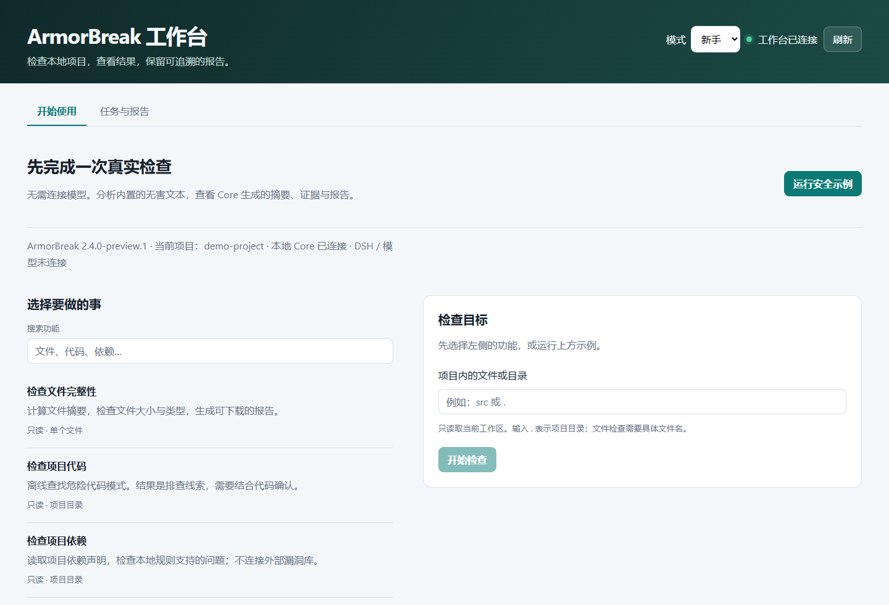

# ArmorBreak · 破甲


ArmorBreak is an independent open-source toolkit for authorized security analysis. Its CLI, MCP server and local Workbench share one Core for scope checks, tasks, evidence and reports. DeepSeek Harness is an integration target. ArmorBreak is maintained independently of DeepSeek.

[Stable v2.3.1](https://github.com/LYL-Z/dsh-armorbreak/releases/tag/v2.3.1) · [Preview v2.4.0-preview.1](https://github.com/LYL-Z/dsh-armorbreak/releases/tag/v2.4.0-preview.1) · [简体中文](README.zh-CN.md)

## Quick start

1. Install Node.js 22 or newer.
2. On Windows, download and verify `ArmorBreak-Windows-Preview.zip` from the Preview release, extract it, then run **Start ArmorBreak.cmd**. The archive includes the app and npm dependencies.
3. In Workbench select **运行安全示例** to try a check without providing any files. Place a copy of a project or file in the workspace, select a check, then open or download the Markdown report.

On Windows, Linux or macOS, use a verified npm TGZ from GitHub Releases or a verified build. Rename the local copy to `armorbreak-candidate.tgz` and install it in a new directory. Use the [distribution guide](docs/v24/distribution.md) for checksums, commands and platform-specific evidence.

```sh
npm install --ignore-scripts ./armorbreak-candidate.tgz
npx --no-install armorbreak start --workspace /absolute/project
```

## What current development builds can do



The screenshot shows the current development build at first launch. Guided mode puts common checks first. Advanced mode opens the full catalog, diagnostics and raw results.

| Task | Result |
| --- | --- |
| Inspect a file, codebase or dependency manifest | Local analysis with evidence and a Markdown report |
| Analyze a saved packet capture | Protocol and session summaries from the supplied file |
| Preview a configuration overlay | Redacted change and conflict summaries |
| Check a plugin package or backup copy | Compare declared files and hashes, with details for supported errors |

Run `armorbreak capabilities --json` to see the capabilities registered by your installed build, including their risk levels. Recent development builds also support snapshot verification against its own manifest and disk-only DSH package diagnostics. See the [changelog](CHANGELOG.md) for what is available at each version.

## Support and project policies

The local Workbench can run read-only tasks without model credentials. Its browser session uses CSRF protection. OS client authentication, production host writes and privileged approvals are unavailable through the panel. An isolated Windows DSH CLI test verified benign native tool execution and a local-model round trip. Desktop/Web integration and production recovery remain under development.

- [Distribution and verification](docs/v24/distribution.md) · [Historical release evidence](https://github.com/LYL-Z/dsh-armorbreak/blob/3919c686271a9b54ab937070e7b547935f4de0ba/docs/readme-audit/v2.2.0-release-facts.md)
- [Get support](SUPPORT.md) · [Report a security issue](SECURITY.md) · [Authorized use](ETHICAL_USE.md)
- [Contribute](CONTRIBUTING.md) · [Governance](GOVERNANCE.md) · [Roadmap](https://github.com/LYL-Z/dsh-armorbreak/blob/main/docs/roadmap.md)
- [MIT License](LICENSE) · [Attribution](NOTICE) · [Third-party notices](THIRD_PARTY_NOTICES.txt) · [Project identity](TRADEMARK.md)
