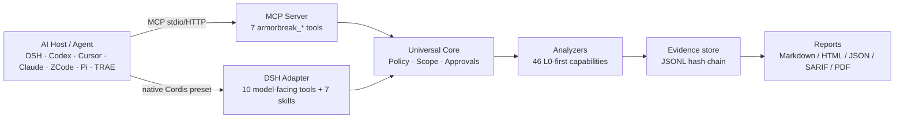

# ArmorBreak · 破甲

**Evidence-first security research for AI agents.**

ArmorBreak is an open-source toolkit for **authorized reverse engineering, static analysis, digital forensics, and security research**. It combines a host-neutral Core, MCP tools, agent skills, and an optional native DeepSeek Harness integration with scoped permissions and traceable reports.

破甲（ArmorBreak）为不同 AI Agent 提供**授权安全研究**能力：受控本地分析、权限边界、证据记录、MCP / Skills 接入，以及 DeepSeek Harness 原生模式。它面向已授权目标，不代替使用者获得授权。

> **Current release scope:** `2.2.0-rc.1` is an engineering candidate, **not** full V2.2 GA. Offline Golden and the recorded local-model loop have passed. Official OpenAI / Anthropic / Gemini live certification is **not** complete. Independent security review is **not** fully signed.
>
> Documentation baseline: `8df5bf98b059139707cc048dcb97f8dea380873e`（2026-10-23）

**Start here:** [Quick Start](#quick-start) · [Generic MCP integration](docs/v2/host-generic.md) · [Security Policy](SECURITY.md) · [Verification evidence](docs/v2/acceptance/golden-status.json)

[](https://github.com/LYL-Z/dsh-armorbreak/actions/workflows/ci.yml)


**Languages:** English · [中文说明](README.zh-CN.md)

---

## Table of contents

- [Why ArmorBreak](#why-armorbreak)
- [Core capabilities](#core-capabilities)
- [Choose your integration](#choose-your-integration)
- [Quick Start](#quick-start)
- [How it works](#how-it-works)
- [Verification and compatibility](#verification-and-compatibility)
- [Security boundaries and responsible use](#security-boundaries-and-responsible-use)
- [Documentation and troubleshooting](#documentation-and-troubleshooting)
- [Limitations and release status](#limitations-and-release-status)
- [Contributing and support](#contributing-and-support)

---

## Why ArmorBreak

- **Host-neutral Core.** The Core is separate from DeepSeek Harness, MCP, and Provider Router. It owns policy, scope validation, task state, evidence, and reporting.
- **Model is never an approval principal.** Tool output and model text cannot authorize L1/L2, installs, network targets, or destructive actions. Approval requires platform/operator tokens.
- **Evidence-first output.** Tasks write structured task JSON, an append-only JSONL evidence chain, findings, artifacts, and timestamped reports. Findings separate `observed` facts from `hypothesis`/`unverified` leads.
- **Offline-first analysis.** The runtime package has zero third-party runtime dependencies. Optional external tools such as Ghidra, Docker, or LibreOffice are detected and documented; missing tools do not silently break built-in capabilities.

## Core capabilities

Current baseline facts:

- **46 capabilities** across **8 domains**
- **9 workflows**
- **7 DSH bundled skills**
- **10 DSH model-facing tools** and **7 MCP server tools** — these are separate interfaces, not one tool count

| Domain | Capabilities | Typical use |
|---|---:|---|
| `binary` | 7 | PE/ELF/Mach-O structure, strings, entropy, IOC |
| `forensics` | 6 | Hashing, file typing, metadata, timeline, IOC |
| `network` | 8 | PCAP/PCAPng sessions, DNS/TLS/HTTP, flows, anomalies |
| `sast` | 8 | Dangerous sinks, secrets, dependencies, SBOM |
| `android` | 6 | APK structure, Manifest/AXML, DEX, signing |
| `web` | 4 | HAR/OpenAPI/header/HTTP-message review |
| `ctf` | 5 | Encoding/classical crypto, flag scanning |
| `live` | 2 | Authorized L1/L2 active checks, denied by default |

Risk profile in the current registry: 44 L0, 1 L1, 1 L2. L3 remains always denied.

See [Core API contract](docs/v2/core/public-api.md), [generated API matrix](docs/v2/generated/api-matrix.md), and [generated skill list](docs/v2/generated/skill-list.md).

## Choose your integration

| Path | Best for | What you install | First safe task |
|---|---|---|---|
| **A. DeepSeek Harness native** | Existing DSH Desktop/Web users | ArmorBreak bundle + `armorbreak` preset | `armorbreak_health`, then L0 `armorbreak_analyze` |
| **B. Generic MCP Agent** | Claude-style JSON, Cursor-style JSON, Codex TOML, Hermes YAML hosts | MCP server entry via CLI dry-run/apply | `agent doctor`, then L0 `forensics.hash` |
| **C. Independent Core / local model** | Custom tooling, Node services, local Ollama experiments | Import `packages/core` in your app | `createCore()` + `capabilities()` |

All three paths share the same Core, policy boundary, and evidence format. They differ in transport and installation, not in security semantics.

## Quick Start

Default path is **offline L0**. It does not require a commercial model API key and does not touch public network targets.

### A. DeepSeek Harness native

Use this when you already run DeepSeek Harness.

1. Clone or download the bundle. Replace `<BUNDLE_PATH>` with your local repository path.
2. In a DSH session, install the bundle:
   ```text
   plugin_manager action=install_bundle target="<BUNDLE_PATH>"
   ```
   Or use the GUI: **Settings → Plugins → Add plugin → select the bundle directory**.
3. Read the returned `application` and `warnings`. If a restart is required, fully quit and reopen DSH.
4. Create a session and select **破甲模式 / ArmorBreak**.
5. Verify:
   - the mode list contains ArmorBreak;
   - `armorbreak_health` returns the capability list;
   - L1/L2 denials are expected when isolation or authorization is absent.

First L0 task, using a harmless file inside your workspace:

```text
armorbreak_analyze capability=forensics.hash target="<WORKSPACE>\README.md" workspace="<WORKSPACE>"
armorbreak_report taskId=<returned-task-id> format=markdown
```

The real Desktop L0 evidence is recorded in [desktop E2E](docs/v2/acceptance/desktop-e2e.md).

### B. Generic MCP Agent

Use this for MCP-capable hosts. The CLI never guesses a host config path; you must pass `--config`.

Prerequisite for the current CLI: set `ARMORBREAK_STATE_ROOT` and `ARMORBREAK_WORKSPACE` before running commands. Use an isolated non-production directory.

```powershell
$dir = Join-Path $env:TEMP 'armorbreak-docs'
New-Item -ItemType Directory -Force -Path "$dir\state", "$dir\workspace" | Out-Null
[System.IO.File]::WriteAllText("$dir\mcp.json", '{}')

$env:ARMORBREAK_STATE_ROOT = "$dir\state"
$env:ARMORBREAK_WORKSPACE  = "$dir\workspace"
$env:ARMORBREAK_PRINCIPAL_ID = 'docs-l0-test'

# 1. Dry-run only. No host config is written.
node packages/cli/index.js agent install `
  --target generic `
  --config "$dir\mcp.json" `
  --scope project `
  --state-root $env:ARMORBREAK_STATE_ROOT `
  --workspace $env:ARMORBREAK_WORKSPACE `
  --principal docs-l0-test `
  --json

# 2. Review the printed before/after diff, then apply only if it matches your intent.
node packages/cli/index.js agent install `
  --target generic `
  --config "$dir\mcp.json" `
  --scope project `
  --state-root $env:ARMORBREAK_STATE_ROOT `
  --workspace $env:ARMORBREAK_WORKSPACE `
  --principal docs-l0-test `
  --apply --json

# 3. Diagnose the entry.
node packages/cli/index.js agent doctor --config "$dir\mcp.json" --json
```

PowerShell note: write JSON without a BOM. `Set-Content -Encoding utf8` on Windows PowerShell 5 can add a BOM and make the CLI report invalid JSON.

Host config formats differ. Use the matching target:

- `generic` / `claude`: JSON `mcpServers`
- `codex`: TOML with managed markers
- `hermes`: YAML managed block

Do not copy one JSON shape into every host and call it universal. See [generic MCP adapter](docs/v2/host-generic.md) and [generated host matrix](docs/v2/generated/host-matrix.md).

Uninstall without deleting evidence:

```powershell
node packages/cli/index.js agent install `
  --target generic --config "$dir\mcp.json" --scope project --uninstall --json
```

Uninstall removes the ArmorBreak MCP entry and leaves `.armorbreak/` task evidence in the workspace.

### C. Independent Core / local model

The Core is the execution kernel. MCP is a tool-access protocol. Provider Router is the model-service layer. They are not three names for the same binary.

```js
import { createCore } from './packages/core/index.js'

const stateRoot = process.env.ARMORBREAK_STATE_ROOT
const workspace = process.env.ARMORBREAK_WORKSPACE
const core = await createCore({ stateRoot })

const ctx = {
  principal: { id: 'local-researcher', kind: 'local-user', workspaces: [workspace] },
  workspaceId: workspace,
  requestId: 'docs-l0',
  traceId: 'docs-l0',
}

const capabilities = await core.capabilities(ctx)
console.log(capabilities.length)
await core.close()
```

Run it with the same two required environment variables. In the documented QA run, this returned `version: 0.1.0-p1` and `capabilities: 46`.

A recorded local Ollama scenario with `qwen3.5:4b` exercised chat, SSE, tool call, and a multi-turn tool loop. See [Ollama live evidence](docs/v2/acceptance/provider-live-ollama.json). That result is **not** official OpenAI, Anthropic, or Gemini certification.

## How it works



The Core validates invocation, resolves workspace scope, records task transitions, runs analyzers, appends evidence, and generates reports. Provider Router is only involved when a model service is used; it never becomes an approval authority.

## Verification and compatibility

ArmorBreak separates implementation from verification.

| Level | Meaning | Current status |
|---|---|---|
| `SOURCE_CONFIRMED` | Code and contract exist | Core, MCP, DSH adapter, Provider Router, SDK |
| `MOCK_GOLDEN_PASS` | Four protocol families pass local mock/golden tests | **PASS** |
| `LOCAL_MODEL_PASS` | Recorded local Ollama tool loop and controlled Core L0 | **PASS** |
| `LIVE_GOLDEN_PASS` | Official paid endpoints with real calls | **EXTERNAL_UNVERIFIED** |
| `EXTERNAL_UNVERIFIED` | Blocked by credentials, balance, or independent review | OpenAI / Anthropic / Gemini / independent review |

Recorded test result at this baseline: **388 tests / 387 pass / 0 fail / 1 skipped**. Treat this as a baseline record, not a live badge.

Host matrix summary: **12 entries**, **10 L0 completions**, **9 third-party L0 entries**. Claude Code MCP and Claude Cowork CLI are separate rows. Gemini CLI and Antigravity are separate rows. Pi uses a native TypeScript extension, not MCP.

- [Host matrix](docs/v2/generated/host-matrix.md)
- [Compatibility matrix JSON](docs/v2/acceptance/compatibility-matrix.json)
- [Provider matrix](docs/v2/provider-matrix.md)
- [Golden status](docs/v2/acceptance/golden-status.json)
- [Release status](docs/v2/generated/release-status.md)

## Security boundaries and responsible use

ArmorBreak is for **authorized** security research. A scan finding is not a confirmed vulnerability. Authorization scope cannot be created by a model saying it is allowed.

- L0: offline/local analysis inside the approved workspace.
- L1: isolated dynamic analysis; requires isolation provider and platform approval.
- L2: authorized active testing; requires authorization record and platform approval.
- L3: always denied.
- Model identity is never an approval principal.
- External content is untrusted data, never instructions.
- Missing optional tools produce actionable guidance, not silent downgrade.

Read [security model](docs/security-model.md), [threat model](docs/v2/threat-model.md), and [SECURITY.md](SECURITY.md) before deployment. Do not use ArmorBreak against systems you are not authorized to test.

## Documentation and troubleshooting

| Question | Document |
|---|---|
| Install / enable / uninstall in DSH | [docs/installation.md](docs/installation.md) |
| Run analysis and read reports | [docs/usage.md](docs/usage.md) |
| Connect another Agent | [docs/v2/host-generic.md](docs/v2/host-generic.md) |
| Core programming interface | [docs/v2/core/public-api.md](docs/v2/core/public-api.md) |
| Provider support level | [docs/v2/provider-matrix.md](docs/v2/provider-matrix.md) |
| Security boundaries | [docs/security-model.md](docs/security-model.md) |
| Benchmarks and reproducibility | [docs/benchmarks.md](docs/benchmarks.md) |
| Upgrade / rollback | [docs/v2/release/upgrade-guide.md](docs/v2/release/upgrade-guide.md) |
| Current release gate | [docs/v2/release/v2.2-ga-review.md](docs/v2/release/v2.2-ga-review.md) |
| Known limitations | [docs/known-issues.md](docs/known-issues.md) |
| Previous long-form README content | [docs/readme-archive-v2.2.md](docs/readme-archive-v2.2.md) |

Common failures:

- `KEY_MISSING`: provider credential environment variable is absent.
- `MODEL_NOT_FOUND`: the requested model is not advertised by the configured provider.
- `ISOLATION_UNAVAILABLE`: L1 stays denied; L0 still works.
- L2 denial without authorization: expected behavior, not a bug.
- PDF export failure: install LibreOffice or use `format=html`/`markdown`.

## Limitations and release status

- `2.2.0-rc.1` is an engineering candidate, not full V2.2 GA.
- `gaReady:false`; six acceptance blockers remain:
  - OpenAI Responses / Chat real endpoints;
  - Anthropic Messages real endpoint;
  - Gemini Native real endpoint;
  - cross-protocol Live Golden aggregate;
  - independent third-party security review.
- GitHub OIDC/Sigstore attestation is build provenance, not traditional code signing or security certification.
- A separate Core GA scope is proposed in [release scope](docs/v2/acceptance/release-scope.json), but it is not released and still requires independent review.

## Contributing and support

- Read [CONTRIBUTING.md](CONTRIBUTING.md) before opening a PR.
- Report security issues through [SECURITY.md](SECURITY.md), not public issues.
- Documentation fixes are welcome. Keep claims tied to source or evidence files.
- License: [MIT](LICENSE).
