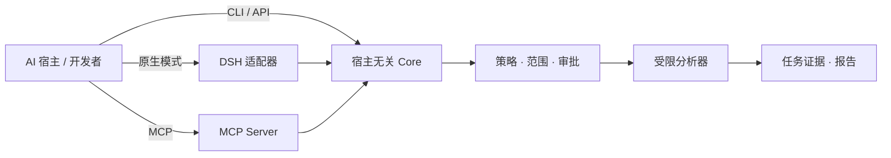

<p align="center">
  
</p>

# ArmorBreak · 破甲

**让 AI Agent 的安全分析有边界、有证据、可复核。**<br>
*工具负责观察，代码负责授权，证据负责说话。*

ArmorBreak 是面向**已授权逆向工程、源码安全审查、网络流量分析、数字取证与安全研究**的开源工具包。它以**宿主无关的 Universal Core** 为核心，通过 **DeepSeek Harness 原生模式**、**MCP** 和**独立 Node.js 接口**接入不同 AI Agent。模型可以协助规划和解读，但不能凭自身回复创建执行授权。

**[快速开始](#本地快速体验)** · **[选择接入方式](#选择接入方式)** · **[真实分析](#真实分析不是概念演示)** · **[文档导航](#文档导航)** · **[English](README.md)**

[](https://github.com/LYL-Z/dsh-armorbreak/actions/workflows/ci.yml)


[](LICENSE)

> [!IMPORTANT]
> **V2.2 Stable 范围：** `2.2.0` 定义为 **Verified Core / Experimental Provider Integrations**。发布必须通过绑定到精确合并后 `main` 提交的版本化 Stable Gate；当前发布状态以 GitHub Releases 页面为准。OpenAI、Anthropic、Gemini 商业端点仍为 `LIVE_UNVERIFIED`。AI 辅助审查按 AI 审查记录披露，不称为人类认证。原 Full GA 记录仍保持 `gaReady:false`，目前列有 18 项阻断。详见 [Stable 政策](docs/v2/release/v2.2-stable-policy-v1.md) 与[验证状态](#验证状态)。

## 为什么选择 ArmorBreak？

| 常见问题 | ArmorBreak 的设计 |
| --- | --- |
| 不同 Agent 重复实现安全分析入口 | **同一个 Core** 服务于 DSH、MCP、CLI 和应用接口 |
| 容易误把模型文本当成操作许可 | **策略与操作者审批**独立于模型 |
| 发现难以定位、重复验证 | **按任务留存证据、哈希、发现和报告** |
| 入门依赖商业模型或公网服务 | **优先使用离线 L0 分析**，按需接入模型和外部工具 |

ArmorBreak 是**安全研究工具包**，不是漏洞真实性担保，也不能代替独立安全评估。

## 本地快速体验

**第一个目标：**查看能力列表，并对隔离工作区内的 README 副本执行一次无害的 L0 文件哈希分析。无需商业模型 Key，也不访问公网测试目标。以下命令使用 **PowerShell 7+**，需安装 **Node.js 22+**，并从仓库根目录执行。相同语法已在 Windows PowerShell 5.1 的文档 QA 中实测；哈希以本次运行结果为准。

```powershell
git clone https://github.com/LYL-Z/dsh-armorbreak.git
cd dsh-armorbreak

$demo = Join-Path $env:TEMP 'armorbreak-first-run'
New-Item -ItemType Directory -Force -Path "$demo/state", "$demo/workspace" | Out-Null
Copy-Item ./README.md "$demo/workspace/README.md"

$env:ARMORBREAK_STATE_ROOT = "$demo/state"
$env:ARMORBREAK_WORKSPACE = "$demo/workspace"
$env:ARMORBREAK_PRINCIPAL_ID = 'first-run-user'

node packages/cli/index.js capabilities --json
node packages/cli/index.js analyze --capability forensics.hash `
  --target "$demo/workspace/README.md" --json
```

**预期结果：**输出能力列表（已记录的 V2.2 基线为 46 项）并生成一个 L0 分析任务。任务 ID、文件哈希以本次运行结果为准。使用 `node packages/cli/index.js task list --json` 查看任务，用 `node packages/cli/index.js report <task-id> --json` 读取报告。若因策略拒绝而失败，应当排查，**不得将拒绝计为成功**。如果已有 clone，可跳过前两条命令。

本次 README 的 smoke run 已对 README 副本完成 `forensics.hash`，产生两条证据和 Markdown 报告。任务 ID 与哈希记录在 [DX smoke 记录](docs/readme-audit/v3-smoke.md)，仅代表该隔离环境的一次运行，不是固定预期输出。

## 选择接入方式

| 你的环境 | 接入方式 | 入门入口 | 实测口径 |
| --- | --- | --- | --- |
| **DeepSeek Harness** | Cordis Bundle + `armorbreak` 原生模式 | [DSH 安装](docs/installation.md) | 已有真实 Desktop L0；上轮 docs QA 未重测 |
| **支持 MCP 的 Agent** | MCP Server + 宿主专用配置 | [MCP 接入](docs/v2/host-generic.md) | 各宿主验证等级不同：[宿主矩阵](docs/v2/generated/host-matrix.md) |
| **自定义 Node.js 程序** | `createCore({ stateRoot })` | [Core API](docs/v2/core/public-api.md) | Core 不依赖 DSH |
| **本地模型实验** | Core + Provider Router + 本地模型 | [Ollama 证据](docs/v2/acceptance/provider-live-ollama.json) | 本地闭环≠官方商业 Provider 认证 |

这些路径共用 Core，但**安装格式和实测强度并不相同**。Codex 使用 TOML，部分 MCP Agent 使用 JSON，Hermes 使用 YAML，Pi 还有原生扩展。不能将同一套 JSON 配置当成所有 Agent 的通用方案。

## 真实分析，不是概念演示

项目仓库保存了一次真实 **DeepSeek Harness Desktop L0** 会话：执行 `forensics.hash`，任务完成，形成两条证据记录和 Markdown 报告。这是 **2026 年 10 月记录的真实测试**，不是实时仪表盘，也不证明所有环境都已安全认证。

| 记录字段 | 值 |
| --- | --- |
| 任务 | `task_mvi33mq6_00e28f71` |
| 能力 | `forensics.hash` |
| 状态 | `COMPLETED` |
| 证据记录 | 2 |
| 输入 SHA-256 | `50eea274f68780a501df2f79aea32fd6785dcc2a2f87a1e198e6f5b7c79e1fc8` |
| 报告 SHA-256 | `bb07c8acb8fb8f247ef936fd4a9588daa49a41dcfc68af9040f4483298365296` |

原始截图包含本机账号/工作区标识，因此不直接嵌入 README。请通过[实测步骤及证据哈希](docs/v2/acceptance/desktop-e2e.md)、[原始报告](docs/v2/acceptance/desktop-l0-report.md)、[本地模型测试](docs/v2/acceptance/provider-live-ollama.json)复核证据。

### 支持哪些分析？

V2.2 基线注册表包含 **8 个领域的 46 项能力**，风险分布为 **44 项 L0、1 项 L1、1 项 L2**，**L3 拒绝**。能力注册成功不意味着所有可选外部分析器均已安装，也不意味着所有平台经过相同强度的验证。

| 领域 | 典型用途 |
| --- | --- |
| 二进制 · 7 | PE/ELF/Mach-O 结构、字符串、元数据与指标 |
| 取证 · 6 | 文件哈希和类型、元数据、时间线 |
| 网络 · 8 | 离线 PCAP、DNS/TLS/HTTP 观察 |
| 源码与供应链 · 8 | 静态发现、依赖审查、供应链分析输入 |
| Android · 6 | APK/DEX 结构、Manifest 与签名 |
| Web · 4 | HAR、OpenAPI、HTTP 报文及 Header 审查 |
| CTF/实验室 · 5 | 授权实验室中的编码与基础密码练习 |
| 主动检查 · 2 | L1/L2 额外审批，默认拒绝 |

另有 **9 个工作流、7 个 DSH Skills、10 个 DSH 模型工具、7 个 MCP Server 工具**。这些是不同层面的统计，**不能简单加总**。参见 [API 矩阵](docs/v2/generated/api-matrix.md)、[Skills 列表](docs/v2/generated/skill-list.md)、[使用指南](docs/usage.md)。

## 工作原理



三个区别必须明确：

1. **Agent 不等于审批方。** 运行时策略检查风险等级、工作区范围与操作者/平台审批。
2. **扫描发现不等于漏洞已证实。** 观察事实、假设、待验证线索不能混淆。
3. **协议 Mock 通过不等于真实 Provider 通过。** 模型路由与安全分析授权属于不同边界。

详见[历史架构设计](docs/readme-archive-v2.2.md)、[Core API](docs/v2/core/public-api.md)、[安全模型](docs/security-model.md)、[威胁模型](docs/v2/threat-model.md)。

## 验证状态

| 项目 | 有证据支持的状态 | 不代表什么 |
| --- | --- | --- |
| Core 与协议实现 | 代码和接口契约存在 | 不代表没有安全漏洞 |
| 四类模型 API 协议 | `MOCK_GOLDEN_PASS` | 不代表官方端点已通过 |
| 本地 Ollama 工具闭环 | `LOCAL_MODEL_PASS` | 不代表 OpenAI/Anthropic/Gemini 实测通过 |
| 官方商业 Provider Live | LIVE_UNVERIFIED | 不代表 OpenAI、Anthropic 或 Gemini 官方端点已认证兼容 |
| 各 Agent 接入 | 各宿主保留不同等级证据 | 不代表所有宿主完成 MCP 模型端到端调用 |
| AI 辅助安全审查 | 报告及针对性复核均注明目标提交和证据 | 不等于人类安全认证，结果不能自动继承到其他 SHA |
| V2.2 Stable | 已定义 Verified Core / Experimental Provider Integrations 范围；发布须通过精确 main Stable Gate | 不代表 Full GA 通过或未验证宿主/Provider 已获支持 |
| 历史 Full V2.2 GA | gaReady:false；记录有 18 项阻断 | Stable 范围或 AI 审查满足独立 Full GA 合同 |

README 更新时最近一轮完整 PR #18 检查为 [CI run 40203187699](https://github.com/LYL-Z/dsh-armorbreak/actions/runs/40203187699)，目标是 PR HEAD `6ad35b0121b546edc6d71efe6691b67eba7505d8`：Windows 529/529、Ubuntu 531/531，失败 0、跳过 0。该结果只绑定到对应 PR HEAD，不能代替后续精确 `main` SHA 的 CI 与来源证明。

**信任边界：**L0 为本地/离线；L1 需要可用隔离及平台审批；L2 需要已授权范围及平台审批；L3 始终拒绝。GitHub OIDC/Sigstore Attestation 属于**构建来源证明**，不是独立安全认证。参见 [SECURITY.md](SECURITY.md)。

## 文档导航

| 你想做什么？ | 阅读位置 |
| --- | --- |
| 安装或卸载 DSH 模式 | [安装指南](docs/installation.md) |
| 运行分析、读取报告 | [使用指南](docs/usage.md) |
| 在其他 Agent 中接入 MCP | [MCP 接入](docs/v2/host-generic.md) · [宿主矩阵](docs/v2/generated/host-matrix.md) |
| 编程调用独立 Core | [Core API](docs/v2/core/public-api.md) |
| 核查模型 API 的实测状态 | [Provider 矩阵](docs/v2/provider-matrix.md) · [Golden 状态](docs/v2/acceptance/golden-status.json) |
| 了解权限及威胁模型 | [安全模型](docs/security-model.md) · [威胁模型](docs/v2/threat-model.md) |
| 升级或回滚 | [升级指南](docs/v2/release/upgrade-guide.md) |
| 查看限制和发布门禁 | [已知问题](docs/known-issues.md) · [Stable 政策](docs/v2/release/v2.2-stable-policy-v1.md) · [历史 Full GA 复核](docs/v2/release/v2.2-ga-review.md) |
| 阅读历史技术长文 | [技术归档](docs/readme-archive-v2.2.md) · [性能基准](docs/benchmarks.md) |

## 贡献与负责任使用

ArmorBreak **仅供已取得明确授权的安全研究和技术测试使用**。所有被分析内容都应视为不可信，采取后续措施前应复核发现。贡献者请阅读 [CONTRIBUTING.md](CONTRIBUTING.md)；漏洞应按 [SECURITY.md](SECURITY.md) **私下报告**，不要公开发布利用细节。项目采用 [MIT 许可证](LICENSE)。

---

*ArmorBreak · 破甲 —— 证据优先，操作者授权，结果可复核。*
