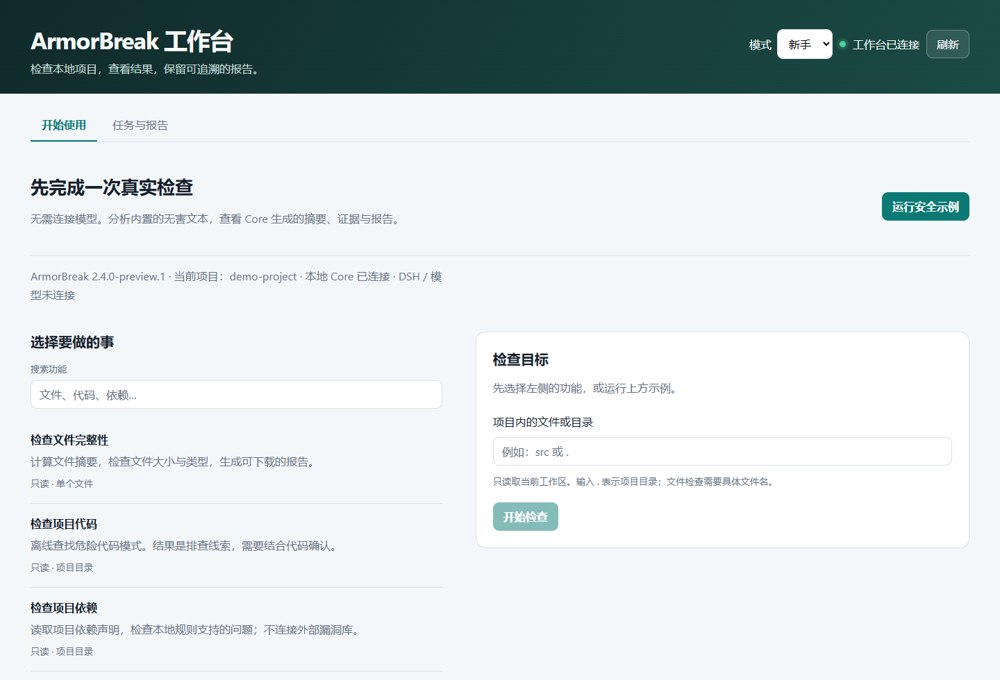

# ArmorBreak · 破甲


ArmorBreak（破甲）是用于已授权安全分析的独立开源工具包。CLI、MCP 和本地 Workbench 共用同一个 Core，负责范围检查、任务、证据和报告。DeepSeek Harness 是可接入的宿主，ArmorBreak 由独立维护者开发。

[下载 Stable v2.3.1](https://github.com/LYL-Z/dsh-armorbreak/releases/tag/v2.3.1) · [下载 Preview v2.4.0-preview.1](https://github.com/LYL-Z/dsh-armorbreak/releases/tag/v2.4.0-preview.1) · [English](README.md)

## 快速开始

1. 安装 Node.js 22 或更新版本。
2. Windows 用户从 Preview 下载并核对 `ArmorBreak-Windows-Preview.zip`，完整解压后打开 **Start ArmorBreak.cmd**。包内已包含应用和 npm 依赖。
3. 在 Workbench 点击 **运行安全示例**，无需提供文件即可体验。把项目或文件的副本放入工作区，选择检查项目，再打开或下载 Markdown 报告。

Windows、Linux 和 macOS 用户也可安装来自 GitHub Release 或已核验构建的 npm TGZ。将本地副本重命名为 `armorbreak-candidate.tgz` 后，在新目录安装。[安装与校验指南](docs/v24/distribution.md)包含校验和、命令与各平台的实际验证范围。

```sh
npm install --ignore-scripts ./armorbreak-candidate.tgz
npx --no-install armorbreak start --workspace /absolute/project
```

## 当前开发版本可以做什么



上图为当前开发版首次启动的实际界面。新手模式集中显示常用检查，高级模式提供完整功能目录、诊断与原始结果。

| 任务 | 结果 |
| --- | --- |
| 检查文件、源码或依赖声明 | 生成带证据的本地分析和 Markdown 报告 |
| 分析已有抓包文件 | 从输入文件汇总协议与会话 |
| 预览配置覆盖 | 汇总变更与冲突，隐藏敏感配置值 |
| 检查插件包或备份副本 | 核对声明的文件与哈希，对支持的错误提供具体提示 |

按 [CLI 能力目录说明](docs/v24/distribution.md#list-the-installed-capabilities)可以查看已安装版本实际注册的能力和风险等级。近期开发构建还支持核对快照与其清单，以及只读识别磁盘上的 DSH 包。各版本包含的功能以[变更日志](CHANGELOG.md)为准。

## 支持与项目政策

本地 Workbench 无需模型凭据即可运行只读任务。浏览器会话提供 CSRF 防护，面板尚未接入 OS 客户端身份、生产宿主写入或特权审批。Windows 上已用隔离 DSH CLI 验证无害的原生工具执行与本机模型结果回传。Desktop/Web 集成和生产恢复仍在开发。

- [安装与校验](docs/v24/distribution.md) · [历史发行证据](https://github.com/LYL-Z/dsh-armorbreak/blob/3919c686271a9b54ab937070e7b547935f4de0ba/docs/readme-audit/v2.2.0-release-facts.md)
- [获取帮助](SUPPORT.md) · [安全问题报告](SECURITY.md) · [授权使用](ETHICAL_USE.md)
- [参与贡献](CONTRIBUTING.md) · [治理](GOVERNANCE.md) · [路线图](https://github.com/LYL-Z/dsh-armorbreak/blob/main/docs/roadmap.md)
- [MIT 许可](LICENSE) · [来源署名](NOTICE) · [第三方通知](THIRD_PARTY_NOTICES.txt) · [项目标识](TRADEMARK.md)
