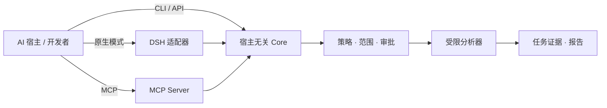

<p align="center">
  
</p>

# ArmorBreak · 破甲

**让 AI Agent 的安全分析有边界、有证据、可复核。**<br>
*工具负责观察，代码负责授权，证据负责说话。*

ArmorBreak 是面向**已授权逆向工程、源码安全审查、网络流量分析、数字取证与安全研究**的开源工具包。它以**宿主无关的 Universal Core** 为核心，通过 **DeepSeek Harness 原生模式**、**MCP** 和**独立 Node.js 接口**接入不同 AI Agent。模型可以协助规划和解读，但不能凭自身回复创建执行授权。

**[下载 Stable 版](https://github.com/LYL-Z/dsh-armorbreak/releases/tag/v2.2.0)** · **[快速开始](#快速开始)** · **[选择接入方式](#选择接入方式)** · **[发布核验](#v220-stable-发布核验)** · **[文档导航](#文档导航)** · **[English](README.md)**

[](https://github.com/LYL-Z/dsh-armorbreak/actions/workflows/ci.yml)


[](LICENSE)

> [!IMPORTANT]
> **V2.2.0 Stable 已正式发布。** 它覆盖 **Verified Core** 与 **Experimental Provider Integrations**。OpenAI、Anthropic、Gemini 商业端点仍为 `LIVE_UNVERIFIED`；AI 辅助安全审查不等于人类认证。历史 **Full GA** 契约仍为 `gaReady:false` 和 18 项阻断。使用结果前请阅读[发布核验](#v220-stable-发布核验)与[范围与限制](#范围与限制)。

## 为什么选择 ArmorBreak？

| 常见问题 | ArmorBreak 的设计 |
| --- | --- |
| 不同 Agent 重复实现安全分析入口 | **同一个 Core** 服务于 DSH、MCP、CLI 和应用接口 |
| 容易误把模型文本当成操作许可 | **策略与操作者审批**独立于模型 |
| 发现难以定位、重复验证 | **按任务留存证据、哈希、发现和报告** |
| 入门依赖商业模型或公网服务 | **优先使用离线 L0 分析**，按需接入模型和外部工具 |

ArmorBreak 是**安全研究工具包**，不是漏洞真实性担保，也不能代替独立安全评估。

## 快速开始

### 方案 A — 校验正式 Stable 资产

Release 页面提供六项资产：portable 归档、构建 manifest、CycloneDX SBOM、SHA-256 列表、Stable Gate 结果和 GitHub attestation。需要 Node.js **22+**；发布 CI 使用 Node 24。

```powershell
$rel = Join-Path $env:TEMP 'armorbreak-v2.2.0'
New-Item -ItemType Directory -Force $rel | Out-Null
gh release download v2.2.0 --repo LYL-Z/dsh-armorbreak --dir $rel

Get-FileHash "$rel\armorbreak-portable-2.2.0.tar.gz" -Algorithm SHA256
Get-Content "$rel\SHA256SUMS.txt"   # 与归档、SBOM 哈希对照

$extract = Join-Path $env:TEMP 'armorbreak-v2.2.0-extracted'
New-Item -ItemType Directory -Force $extract | Out-Null
tar -xzf "$rel\armorbreak-portable-2.2.0.tar.gz" -C $extract
Set-Location $extract
```

归档 SHA-256：`5e5aca98da18d4f0cb17db71cf57c5577f8f8f64810a30844bd5237b4ed7b630`<br>
SBOM SHA-256：`2fd47a2b3970c563a747dffb093a33c042de2488b832604dbcce65ec374755a4`

用 GitHub CLI 校验来源：

```powershell
gh attestation verify "$rel\armorbreak-portable-2.2.0.tar.gz" `
  --repo LYL-Z/dsh-armorbreak `
  --cert-identity "https://github.com/LYL-Z/dsh-armorbreak/.github/workflows/attest.yml@refs/heads/main" `
  --source-ref refs/heads/main `
  --source-digest 94d606ed934d7d288c2946ae7d9d25582d8204a4 `
  --predicate-type https://slsa.dev/provenance/v1
```

### 方案 B — 使用冻结源码 Tag

```powershell
git clone --branch v2.2.0 --depth 1 https://github.com/LYL-Z/dsh-armorbreak.git
cd dsh-armorbreak
```

### 第一个无害 L0 任务

在解压后的发行包或 Tag 源码目录中执行：

```powershell
$demo = Join-Path $env:TEMP 'armorbreak-first-run'
New-Item -ItemType Directory -Force -Path "$demo/state", "$demo/workspace" | Out-Null
Copy-Item ./README.md "$demo/workspace/README.md"

$env:ARMORBREAK_STATE_ROOT = "$demo/state"
$env:ARMORBREAK_WORKSPACE = "$demo/workspace"
$env:ARMORBREAK_PRINCIPAL_ID = 'first-run-user'

node packages/cli/index.js capabilities --json
node packages/cli/index.js analyze --capability forensics.hash `
  --target "$demo/workspace/README.md" --json
node packages/cli/index.js task list --json
node packages/cli/index.js report <task-id> --json
```

**预期结果：**46 项已注册能力，以及一个带真实任务 ID 和证据的已完成 L0 任务。策略拒绝不等于成功；请检查 `ARMORBREAK_STATE_ROOT`、`ARMORBREAK_WORKSPACE`、目标和策略。正式发行 smoke 记录见 [v4-release-smoke.md](docs/readme-audit/v4-release-smoke.md)。

## V2.2.0 Stable 发布核验

| 事实 | 记录值 |
| --- | --- |
| 发布 | [v2.2.0 Stable](https://github.com/LYL-Z/dsh-armorbreak/releases/tag/v2.2.0)，2026-10-26 |
| 冻结源码 / Tag Commit | `94d606ed934d7d288c2946ae7d9d25582d8204a4` |
| 当前 main（文档基线） | `60273394dff3386354df42ef852964f240a79145` |
| 发布 CI | [40320111438](https://github.com/LYL-Z/dsh-armorbreak/actions/runs/40320111438)，**5/5 Job 成功** |
| 精确源码测试 | Windows **530/530**，Ubuntu **532/532**，0 failed/skipped/cancelled |
| Stable Gate | **12/12 PASS**，`releasable:true`；附件 `stable-gate.json` |
| 来源证明 | [attestation 40320111461](https://github.com/LYL-Z/dsh-armorbreak/actions/runs/40320111461)，本地 `gh attestation verify` 成功 |
| Portable 归档 | 5,338,540 bytes；SHA-256 `5e5aca98da18d4f0cb17db71cf57c5577f8f8f64810a30844bd5237b4ed7b630` |
| CycloneDX SBOM | 88,082 bytes；SHA-256 `2fd47a2b3970c563a747dffb093a33c042de2488b832604dbcce65ec374755a4` |
| 六项 Release 资产 | 归档、构建 manifest、SBOM、`SHA256SUMS.txt`、`stable-gate.json`、`github-attestation.json` |

Tag 与当前 main 是**不同提交**。`94d606e…` 是不可变发行源码；`6027339…` 是后续文档/测试上下文维护。不能把当前 main 构建称为原始发行包，也不能替换已发布资产。

发布 Tag 的原始 CI 也保留了一次 **test-context failure**：两条断言假设正式 Tag 尚不存在。PR #21 修正上下文假设，未删除 Full GA 拒绝断言、未跳过测试；发布后的 main CI [40322961617](https://github.com/LYL-Z/dsh-armorbreak/actions/runs/40322961617) 和 attestation [40322961644](https://github.com/LYL-Z/dsh-armorbreak/actions/runs/40322961644) 通过。原始失败记录和 Release 资产未被改写。

## 选择接入方式

| 你的环境 | 接入方式 | 入门入口 | 实测口径 |
| --- | --- | --- | --- |
| **DeepSeek Harness** | Cordis Bundle + `armorbreak` 原生模式 | [DSH 安装](docs/installation.md) | 已有真实 Desktop L0；本次 docs QA 未重测 |
| **支持 MCP 的 Agent** | MCP Server + 宿主专用配置 | [MCP 接入](docs/v2/host-generic.md) | 各宿主等级不同：[宿主矩阵](docs/v2/generated/host-matrix.md) |
| **自定义 Node.js 程序** | `createCore({ stateRoot })` | [Core API](docs/v2/core/public-api.md) | Core 不依赖 DSH |
| **本地模型实验** | Core + Provider Router + 本地运行时 | [Ollama 证据](docs/v2/acceptance/provider-live-ollama.json) | 本地闭环≠商业 Provider 认证 |

Codex 使用 TOML，部分 MCP Agent 使用 JSON，Hermes 使用 YAML，Pi 还有原生扩展。不能将一套配置复制到所有宿主。

## 范围与限制

- **46 项能力 / 8 个领域**：**44 L0、1 L1、1 L2**，**L3 拒绝**。注册成功不意味着所有可选外部分析器均已安装。
- **9 个工作流、7 个 DSH Skills、10 个 DSH 模型工具、7 个 MCP 工具**；这些接口不能相加成一个数字。
- **12 个宿主入口 / 10 个 L0 / 9 个第三方 L0**；每个宿主保留自己的证据等级。Claude Code MCP 与 Claude Cowork CLI、Gemini CLI 与 Antigravity 分开记录。
- **Verified Core：**Universal Core、MCP Server、Skills、Offline Golden、已记录的本地模型验证，以及发布 CI 覆盖的安装/迁移/回滚路径。
- **Experimental Provider Integrations：**OpenAI-compatible、OpenAI Responses、Anthropic Messages、Gemini Native 均为 `LIVE_UNVERIFIED`；Mock 与本地结果不代表官方商业端点认证。
- **历史 Full GA：**`gaReady:false`，18 项阻断。Stable 是独立、经所有者批准的发布契约，不免除 Full GA。
- **AI 审查：**四轮 AI 辅助审查完成初审，发现仍需修复/复测；不构成独立人类审计或认证。
- **来源证明：**GitHub OIDC/Sigstore 证明构建来源与资产绑定，不是安全认证或生产代码签名。

**风险等级：**L0 本地/离线；L1 需要隔离和平台审批；L2 需要授权范围和平台审批；L3 始终拒绝。参见[安全政策](SECURITY.md)、[Stable 政策](docs/v2/release/v2.2-stable-policy-v1.md)、[GA 复核](docs/v2/release/v2.2-ga-review.md)。

## 工作原理



1. **Agent 不等于审批方。** 运行时策略检查风险、范围和操作者/平台审批。
2. **扫描发现不等于漏洞已证实。** 事实、假设、待验证线索分开记录。
3. **协议 Mock 通过不等于真实 Provider 通过。** 模型路由与安全分析授权是不同边界。

## 文档导航

| 你想做什么？ | 阅读位置 |
| --- | --- |
| 下载并校验 Stable 资产 | [v2.2.0 Release](https://github.com/LYL-Z/dsh-armorbreak/releases/tag/v2.2.0) · [SHA256SUMS](https://github.com/LYL-Z/dsh-armorbreak/releases/download/v2.2.0/SHA256SUMS.txt) |
| 安装/卸载 DSH 模式 | [安装指南](docs/installation.md) |
| 运行分析与读取报告 | [使用指南](docs/usage.md) |
| 接入其他 Agent | [MCP 接入](docs/v2/host-generic.md) · [宿主矩阵](docs/v2/generated/host-matrix.md) |
| 编程调用独立 Core | [Core API](docs/v2/core/public-api.md) |
| 核查 Provider 状态 | [Provider 矩阵](docs/v2/provider-matrix.md) · [Golden 状态](docs/v2/acceptance/golden-status.json) |
| 阅读 Stable 政策与发布说明 | [Stable 政策](docs/v2/release/v2.2-stable-policy-v1.md) · [发布说明](docs/releases/v2.2.0.md) |
| 审阅正式发行事实记录 | [v2.2.0 发行事实](docs/readme-audit/v2.2.0-release-facts.md) |
| 升级或回滚 | [升级指南](docs/v2/release/upgrade-guide.md) |
| 查看历史 Full GA 阻断 | [GA 复核](docs/v2/release/v2.2-ga-review.md) · [阻断映射](docs/v2/acceptance/blocker-map.json) |
| 阅读历史技术长文 | [技术归档](docs/readme-archive-v2.2.md) · [性能基准](docs/benchmarks.md) |

## 贡献与负责任使用

ArmorBreak **仅供已取得明确授权的安全研究和技术测试使用**。所有被分析内容都应视为不可信，采取后续措施前应复核发现。贡献者请阅读 [CONTRIBUTING.md](CONTRIBUTING.md)；漏洞应按 [SECURITY.md](SECURITY.md) **私下报告**，不要公开发布利用细节。项目采用 [MIT 许可证](LICENSE)。

---

*ArmorBreak · 破甲 —— 证据优先，操作者授权，结果可复核。*
