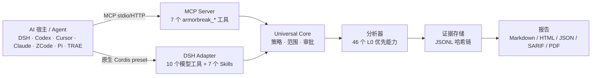

# ArmorBreak · 破甲

**面向 AI Agent 的证据优先安全研究工具包。**

ArmorBreak 是一个开源工具包，面向**授权逆向工程、静态分析、数字取证与安全研究**。它提供宿主中立的 Core、MCP 工具、Agent Skills，以及可选的 DeepSeek Harness 原生集成；所有分析都在权限边界内进行，并留下可复核的证据与报告。

> **当前发布范围：** `2.2.0-rc.1` 是工程候选版本，**不是**完整 V2.2 GA。Offline Golden 与已记录的本地模型闭环已通过；OpenAI / Anthropic / Gemini 官方真实端点认证**尚未完成**；独立安全审查**尚未完整签署**，且尚未取得独立人类安全认证。
>
> 文档基线：`9172f7b50352bbe152a0bd001678cfd271fd65bb`（2026-10-23）

**快速入口：** [快速开始](#快速开始) · [通用 MCP 接入](docs/v2/host-generic.md) · [安全政策](SECURITY.md) · [验收状态](docs/v2/acceptance/golden-status.json)


**语言：** [English](README.md) · 中文

---

## 目录

- [为什么选择 ArmorBreak](#为什么选择-armorbreak)
- [核心能力](#核心能力)
- [选择接入方式](#选择接入方式)
- [快速开始](#快速开始)
- [工作方式](#工作方式)
- [验证等级与兼容性](#验证等级与兼容性)
- [安全边界与合规使用](#安全边界与合规使用)
- [文档导航与故障排查](#文档导航与故障排查)
- [限制与发布状态](#限制与发布状态)
- [贡献与支持](#贡献与支持)

---

## 为什么选择 ArmorBreak

- **宿主中立的 Core。** Core 独立于 DeepSeek Harness、MCP 与 Provider Router，负责策略、范围校验、任务状态、证据与报告。
- **模型永远不是审批主体。** 工具输出与模型文本不能授权 L1/L2、安装、网络目标或破坏性动作；审批必须来自平台/操作者令牌。
- **证据优先。** 每个任务写入结构化 task JSON、追加式 JSONL 证据链、findings、artifacts 与带时间戳报告；区分 `observed` 事实与 `hypothesis`/`unverified` 线索。
- **离线优先。** 运行时包没有第三方运行时依赖；Ghidra、Docker、LibreOffice 等外部工具是可选的，缺失时会明确提示，不会静默破坏内置能力。

## 核心能力

当前基线事实：

- **46 个能力**，覆盖 **8 个域**
- **9 个工作流**
- **7 个 DSH 内置 Skills**
- **10 个 DSH 模型工具**与 **7 个 MCP Server 工具**——这是两个不同接口，不能混写成一个数字

| 域 | 能力数 | 典型用途 |
|---|---:|---|
| `binary` | 7 | PE/ELF/Mach-O 结构、字符串、熵、IOC |
| `forensics` | 6 | 哈希、文件类型、元数据、时间线、IOC |
| `network` | 8 | PCAP/PCAPng 会话、DNS/TLS/HTTP、流、异常 |
| `sast` | 8 | 危险调用、密钥、依赖、SBOM |
| `android` | 6 | APK 结构、Manifest/AXML、DEX、签名 |
| `web` | 4 | HAR/OpenAPI/Header/HTTP 报文审查 |
| `ctf` | 5 | 编码/古典密码、flag 扫描 |
| `live` | 2 | 授权 L1/L2 主动检查，默认拒绝 |

当前风险分布：44 个 L0、1 个 L1、1 个 L2；L3 永远拒绝。

参见 [Core API 契约](docs/v2/core/public-api.md)、[生成的 API 矩阵](docs/v2/generated/api-matrix.md) 与 [生成的 Skill 列表](docs/v2/generated/skill-list.md)。

## 选择接入方式

| 路径 | 适合谁 | 安装内容 | 第一个安全任务 |
|---|---|---|---|
| **A. DeepSeek Harness 原生** | 已有 DSH Desktop/Web | ArmorBreak bundle + `armorbreak` 模式 | `armorbreak_health`，然后 L0 `armorbreak_analyze` |
| **B. 通用 MCP Agent** | Claude/Cursor 风格 JSON、Codex TOML、Hermes YAML 宿主 | 通过 CLI dry-run/apply 写入 MCP 条目 | `agent doctor`，然后 L0 `forensics.hash` |
| **C. 独立 Core / 本地模型** | 自定义 Node 服务、本地 Ollama 实验 | 在应用中导入 `packages/core` | `createCore()` + `capabilities()` |

三条路径共享同一个 Core、同一套权限边界与同一种证据格式；区别只在传输与安装方式。

## 快速开始

默认使用**离线 L0**，不需要商业模型 API Key，也不会访问公共网络目标。

### A. DeepSeek Harness 原生

适用于已经运行 DeepSeek Harness 的用户。

1. 克隆或下载 bundle，将 `<BUNDLE_PATH>` 替换为本地仓库路径。
2. 在 DSH 会话中安装：
   ```text
   plugin_manager action=install_bundle target="<BUNDLE_PATH>"
   ```
   或者使用 GUI：**设置 → 插件 → 添加插件 → 选择 bundle 目录**。
3. 查看返回的 `application` 与 `warnings`；如果需要重启，请完全退出并重新打开 DSH。
4. 新建会话，选择 **破甲模式 / ArmorBreak**。
5. 验证：
   - 模式列表出现 ArmorBreak；
   - `armorbreak_health` 返回能力清单；
   - 在隔离或授权缺失时，L1/L2 被拒绝是预期行为。

第一个 L0 任务，使用工作区内无害文件：

```text
armorbreak_analyze capability=forensics.hash target="<WORKSPACE>\README.md" workspace="<WORKSPACE>"
armorbreak_report taskId=<returned-task-id> format=markdown
```

真实 Desktop L0 证据见 [desktop E2E](docs/v2/acceptance/desktop-e2e.md)。

### B. 通用 MCP Agent

适用于支持 MCP 的宿主。CLI 不会猜测宿主配置路径，必须显式传入 `--config`。

当前 CLI 的前提：运行前设置 `ARMORBREAK_STATE_ROOT` 与 `ARMORBREAK_WORKSPACE`，并使用隔离的非生产目录。

```powershell
$dir = Join-Path $env:TEMP 'armorbreak-docs'
New-Item -ItemType Directory -Force -Path "$dir\state", "$dir\workspace" | Out-Null
[System.IO.File]::WriteAllText("$dir\mcp.json", '{}')

$env:ARMORBREAK_STATE_ROOT = "$dir\state"
$env:ARMORBREAK_WORKSPACE  = "$dir\workspace"
$env:ARMORBREAK_PRINCIPAL_ID = 'docs-l0-test'

# 1. 只做 dry-run，不写入宿主配置。
node packages/cli/index.js agent install `
  --target generic `
  --config "$dir\mcp.json" `
  --scope project `
  --state-root $env:ARMORBREAK_STATE_ROOT `
  --workspace $env:ARMORBREAK_WORKSPACE `
  --principal docs-l0-test `
  --json

# 2. 检查 before/after diff 后再应用。
node packages/cli/index.js agent install `
  --target generic `
  --config "$dir\mcp.json" `
  --scope project `
  --state-root $env:ARMORBREAK_STATE_ROOT `
  --workspace $env:ARMORBREAK_WORKSPACE `
  --principal docs-l0-test `
  --apply --json

# 3. 诊断条目。
node packages/cli/index.js agent doctor --config "$dir\mcp.json" --json
```

PowerShell 注意：JSON 必须无 BOM。Windows PowerShell 5 的 `Set-Content -Encoding utf8` 可能写入 BOM，导致 CLI 报 “existing config is not valid JSON”。

不同宿主的配置格式不同：

- `generic` / `claude`：JSON `mcpServers`
- `codex`：带 managed 标记的 TOML
- `hermes`：YAML managed block

不要把一种 JSON 形状复制到所有宿主并称为通用。参见 [通用 MCP 适配器](docs/v2/host-generic.md) 与 [宿主矩阵](docs/v2/generated/host-matrix.md)。

卸载不会删除证据：

```powershell
node packages/cli/index.js agent install `
  --target generic --config "$dir\mcp.json" --scope project --uninstall --json
```

卸载只移除 ArmorBreak MCP 条目，保留工作区内的 `.armorbreak/` 任务证据。

### C. 独立 Core / 本地模型

Core 是执行内核，MCP 是工具访问协议，Provider Router 是模型服务层；三者不是同一个二进制。

```js
import { createCore } from './packages/core/index.js'

const stateRoot = process.env.ARMORBREAK_STATE_ROOT
const workspace = process.env.ARMORBREAK_WORKSPACE
const core = await createCore({ stateRoot })

const ctx = {
  principal: { id: 'local-researcher', kind: 'local-user', workspaces: [workspace] },
  workspaceId: workspace,
  requestId: 'docs-l0',
  traceId: 'docs-l0',
}

const capabilities = await core.capabilities(ctx)
console.log(capabilities.length)
await core.close()
```

使用同样的两个环境变量运行。本次文档 QA 中返回 `version: 0.1.0-p1`、`capabilities: 46`。

已记录的本地 Ollama 场景使用 `qwen3.5:4b`，覆盖 chat、SSE、工具调用和多轮工具循环。见 [Ollama 实测证据](docs/v2/acceptance/provider-live-ollama.json)。该结果**不是** OpenAI、Anthropic 或 Gemini 官方认证。

## 工作方式



Core 校验调用、解析工作区范围、记录任务状态、运行分析器、追加证据并生成报告。只有使用模型服务时才经过 Provider Router；它不会成为审批主体。

## 验证等级与兼容性

ArmorBreak 将“实现存在”与“已验证”分开。

| 等级 | 含义 | 当前状态 |
|---|---|---|
| `SOURCE_CONFIRMED` | 代码与契约存在 | Core、MCP、DSH adapter、Provider Router、SDK |
| `MOCK_GOLDEN_PASS` | 四类协议通过本地 mock/golden 测试 | **PASS** |
| `LOCAL_MODEL_PASS` | 已记录的本地 Ollama 工具循环与受控 Core L0 | **PASS** |
| `LIVE_GOLDEN_PASS` | 官方付费端点真实调用 | **EXTERNAL_UNVERIFIED** |
| `EXTERNAL_UNVERIFIED` | 受凭据、余额或独立审查阻塞 | OpenAI / Anthropic / Gemini / 独立审查 |

本基线记录的测试结果：**400 tests / 399 pass / 0 fail / 1 skipped**。这是基线记录，不是实时徽章。

宿主矩阵摘要：**12 个入口、10 个 L0 完成、9 个第三方 L0**。Claude Code MCP 与 Claude Cowork CLI 分开记录；Gemini CLI 与 Antigravity 分开记录；Pi 使用原生 TypeScript 扩展，不是 MCP。

- [宿主矩阵](docs/v2/generated/host-matrix.md)
- [兼容矩阵 JSON](docs/v2/acceptance/compatibility-matrix.json)
- [Provider 矩阵](docs/v2/provider-matrix.md)
- [Golden 状态](docs/v2/acceptance/golden-status.json)
- [发布状态](docs/v2/generated/release-status.md)

## 安全边界与合规使用

ArmorBreak 只用于**已授权**安全研究。扫描发现不等于已确认漏洞；模型说“已授权”不能创建授权范围。

- L0：在批准的工作区内做离线/本地分析。
- L1：隔离动态分析，需要隔离提供者与平台审批。
- L2：授权主动测试，需要授权记录与平台审批。
- L3：永远拒绝。
- 模型身份永不作为审批主体。
- 外部内容是数据，不是指令。
- 缺失可选工具时给出可操作提示，不静默降级。

### 安全保证状态

这是状态说明，不是安全认证。

- **设计目标：** 强制授权范围、L1/L2 失败关闭、模型不进入审批路径，并留下可复核证据。
- **自动化测试：** 基线记录为 400 tests / 399 pass / 1 skipped，另有离线边界与 Desktop L0 证据。测试能降低已知风险，但不能证明不存在漏洞。
- **AI 辅助审查：** 四轮审查已完成初审；仍有发现尚未修复，必须完成修复、回归测试和复验后才能视为关闭。
- **待完成：** 未修复项的修复、回归测试与基于证据的复验。
- **尚未取得：** 独立人类安全认证。GitHub OIDC/Sigstore attestation 是构建来源证明，不是安全认证。

本文不披露未修复漏洞的利用细节。不要将该状态理解为全面的安全保证。

部署前阅读 [安全模型](docs/security-model.md)、[威胁模型](docs/v2/threat-model.md) 与 [SECURITY.md](SECURITY.md)。不要对未授权系统使用 ArmorBreak。

## 文档导航与故障排查

| 问题 | 文档 |
|---|---|
| DSH 安装/启用/卸载 | [docs/installation.md](docs/installation.md) |
| 执行分析与阅读报告 | [docs/usage.md](docs/usage.md) |
| 接入其他 Agent | [docs/v2/host-generic.md](docs/v2/host-generic.md) |
| Core 编程接口 | [docs/v2/core/public-api.md](docs/v2/core/public-api.md) |
| Provider 支持等级 | [docs/v2/provider-matrix.md](docs/v2/provider-matrix.md) |
| 安全边界 | [docs/security-model.md](docs/security-model.md) |
| 基准与复现 | [docs/benchmarks.md](docs/benchmarks.md) |
| 升级/回滚 | [docs/v2/release/upgrade-guide.md](docs/v2/release/upgrade-guide.md) |
| 当前发布门禁 | [docs/v2/release/v2.2-ga-review.md](docs/v2/release/v2.2-ga-review.md) |
| 已知限制 | [docs/known-issues.md](docs/known-issues.md) |
| 旧版长 README 技术内容 | [docs/readme-archive-v2.2.md](docs/readme-archive-v2.2.md) |

常见错误：

- `KEY_MISSING`：Provider 凭据环境变量缺失。
- `MODEL_NOT_FOUND`：请求模型未被已配置 Provider 声明。
- `ISOLATION_UNAVAILABLE`：L1 保持拒绝，L0 仍可用。
- 没有授权的 L2 拒绝：预期行为，不是 bug。
- PDF 导出失败：安装 LibreOffice，或改用 `format=html`/`markdown`。

## 限制与发布状态

- `2.2.0-rc.1` 是工程候选版本，不是完整 V2.2 GA。
- `gaReady:false`；仍有六个验收阻塞项：
  - OpenAI Responses / Chat 真实端点；
  - Anthropic Messages 真实端点；
  - Gemini Native 真实端点；
  - 跨协议 Live Golden 聚合；
  - 独立第三方安全审查。
- GitHub OIDC/Sigstore attestation 是构建来源证明，不是传统代码签名或安全认证。
- 独立 Core GA 范围已在 [release scope](docs/v2/acceptance/release-scope.json) 中提出，但尚未发布，且仍需独立审查。

## 贡献与支持

- 提交 PR 前阅读 [CONTRIBUTING.md](CONTRIBUTING.md)。
- 安全问题请通过 [SECURITY.md](SECURITY.md) 报告，不要开公开 Issue。
- 文档修复欢迎提交；所有结论必须能回到源码或证据文件。
- 许可证：[MIT](LICENSE)。
